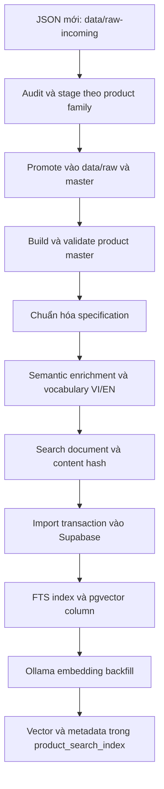
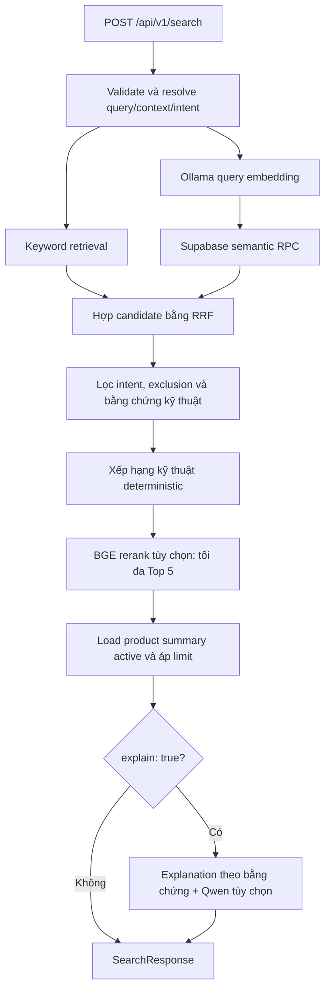

# REECO AI Search — Quy trình dữ liệu, Supabase, pgvector và model local

Ngày đối chiếu mã nguồn: **07/10/2026**.

Tài liệu mô tả các bước đã được triển khai trong repository, kèm hướng dẫn cấu hình và vận hành. Khi tài liệu cũ khác code, nội dung dưới đây ưu tiên code hiện tại. Các lệnh chạy từ thư mục gốc dự án, ví dụ PowerShell trên Windows. Các đoạn JSON/SQL ghi là minh họa không phải kết quả chạy thực tế.

Phạm vi gồm chuẩn bị catalog, chuẩn hóa thông số, làm giàu ngữ nghĩa, tạo search document, kết nối/import Supabase, tạo pgvector, embedding, keyword/semantic/hybrid search, kiểm tra kỹ thuật, rerank, explanation, hội thoại và kiểm thử. Thanh toán, đơn hàng và nghiệp vụ thương mại chỉ được nhắc khi liên quan đến migration/import.

## Mục lục

1. [Kiến trúc và hai luồng chính](#1-kiến-trúc-và-hai-luồng-chính)
2. [Dữ liệu đầu vào và xử lý catalog](#2-dữ-liệu-đầu-vào-và-xử-lý-catalog)
3. [Chuẩn hóa specification](#3-chuẩn-hóa-specification)
4. [Semantic enrichment và search document](#4-semantic-enrichment-và-search-document)
5. [Kết nối Supabase](#5-kết-nối-supabase)
6. [Database, pgvector và RPC](#6-database-pgvector-và-rpc)
7. [Import và đồng bộ dữ liệu](#7-import-và-đồng-bộ-dữ-liệu)
8. [Embedding sản phẩm và truy vấn](#8-embedding-sản-phẩm-và-truy-vấn)
9. [Luồng AI search khi nhận request](#9-luồng-ai-search-khi-nhận-request)
10. [Tích hợp model local cho rerank](#10-tích-hợp-model-local-cho-rerank)
11. [Tích hợp model local cho explanation](#11-tích-hợp-model-local-cho-explanation)
12. [API, frontend và hội thoại](#12-api-frontend-và-hội-thoại)
13. [Quy trình chạy từ đầu và cập nhật](#13-quy-trình-chạy-từ-đầu-và-cập-nhật)
14. [Kiểm thử và đánh giá](#14-kiểm-thử-và-đánh-giá)
15. [Lỗi thường gặp và cách kiểm tra](#15-lỗi-thường-gặp-và-cách-kiểm-tra)
16. [Bản đồ mã nguồn và tài liệu](#16-bản-đồ-mã-nguồn-và-tài-liệu)

## 1. Kiến trúc và hai luồng chính

### 1.1. Các thành phần

| Thành phần | Vai trò | Đường dẫn/cổng mặc định |
|---|---|---|
| React client | Gửi truy vấn, hiển thị kết quả và giải thích | `apps/client`, 5173 |
| React admin | Xem/quản lý sản phẩm, gọi import | `apps/admin`, 5174 |
| NestJS API | Điều phối retrieval, lọc, xếp hạng, rerank và explanation | `apps/api`, 3000 |
| Shared Zod contracts | Kiểm tra request, response và cấu trúc dữ liệu | `packages/shared` |
| Supabase PostgreSQL | Lưu catalog, specification, document, search index và vector | Project cấu hình trong backend |
| Ollama | Chạy embedding và model ngôn ngữ local | `127.0.0.1:11434` |
| FastAPI reranker | Chạy cross-encoder BGE local | `services/reranker`, `127.0.0.1:8011` |
| Script Node.js | Xử lý dữ liệu, import, backfill, đánh giá | `scripts` |

### 1.2. Luồng chuẩn bị dữ liệu



Đối với catalog đã tồn tại, có thể bắt đầu từ bước build master. Dự án đang xử lý **JSON catalog đã được chuẩn bị**; các script trên không phải bộ crawl website, OCR hay trích xuất PDF tổng quát.

### 1.3. Luồng truy vấn thông thường



Có các nhánh riêng cho câu hỏi giải thích có context và nhu cầu hệ thống nhiều thành phần; xem phần 9 và 12. Những nhánh này không nhất thiết chạy một lần retrieval như truy vấn thông thường.

### 1.4. Ba model có ba nhiệm vụ khác nhau

| Nhiệm vụ | Model trong dự án | Input → output | Runtime |
|---|---|---|---|
| Embedding | `qwen3-embedding:4b` | Text → vector 1536 chiều | Ollama `/api/embed` |
| Rerank | `BAAI/bge-reranker-v2-m3` | Cặp query/document → logit và thứ tự | Python Transformers/FastAPI |
| Explanation | `qwen3:4b-instruct-2507-q4_K_M` là model được tài liệu dự án dùng | Query + bằng chứng + phương án câu chữ → lựa chọn phương án | Ollama `/api/chat` |

Embedding không sinh lời giải thích. BGE không phải model chat. Model explanation không quyết định sản phẩm hỗ trợ protocol hay đạt dải nhiệt độ; các kết luận đó phải đến từ dữ liệu và bộ kiểm tra deterministic.

## 2. Dữ liệu đầu vào và xử lý catalog

### 2.1. Các lớp dữ liệu

| Lớp | Vị trí | Nội dung |
|---|---|---|
| Incoming | `data/raw-incoming/*.json` | Dữ liệu mới, có thể là raw document hoặc wrapper chứa `raw_json`/`canonical_json` |
| Staged | `data/raw-staged/*.json` | Product family đã được gom, giữ representative và variant |
| Raw | `data/raw/*.json` | Thông số nguồn, taxonomy, documents, media, provenance |
| Canonical master | `data/master/product-master.json` | Identity và taxonomy chuẩn, URL/media, trạng thái |
| Source metadata | `data/master/product-master-source.json` | Metadata canonical nguồn phục vụ đối chiếu |
| Family curation | `data/master/product-family-curation.json` | Quyết định biên tập representative/family |
| Normalized | `data/normalized/specifications/*.json` | Thông số đã parse, canonical key và tham chiếu raw |
| Enriched | `data/enriched/products/*.json` | Measurements, applications, capabilities, protocol, keyword VI/EN |
| Ontology | `data/ontology/semantic-vocabulary.json` | Vocabulary ngữ nghĩa dùng chung |
| Search document | `data/search-documents/*.json` | Document hợp nhất cho retrieval và evidence |
| Reports | `data/reports/*.json` | Audit, validation, import, embedding và evaluation |

### 2.2. Audit dữ liệu mới

```powershell
npm run audit:raw-incoming
```

Script đọc các file incoming, so với raw và master; kiểm tra cấu trúc `products`, các trường `product_id`, `model`, `specifications`, ID trùng, ID đã tồn tại và canonical record. Report: `data/reports/raw-incoming-audit.json`.

Audit là bước phát hiện vấn đề. Một JSON hợp lệ về cú pháp vẫn có thể sai identity, thiếu taxonomy, trùng sản phẩm hoặc gán nhầm thông số variant.

### 2.3. Stage theo product family

```powershell
npm run stage:raw-incoming
```

Script unwrap input, chuẩn hóa product ID về chữ hoa, gom các file có chung product ID, chọn raw record tốt hơn khi trùng ID và chọn representative ưu tiên master hiện có, rồi canonical record. Curation có thể ghi đè identity/taxonomy của representative.

Các variant được giữ trong `products[0].variants`, kèm thông số phân biệt và provenance. Report: `data/reports/raw-incoming-staging-report.json`. Cần xem các family thiếu canonical field trước khi promote.

Không được hiểu rằng mọi specification của representative đều áp dụng cho mọi variant. Giới hạn giao tiếp, cấu hình và điều kiện riêng của variant phải được kiểm tra trong dữ liệu phân biệt.

### 2.4. Promote vào dữ liệu chính

```powershell
# Lập kế hoạch, chưa sửa raw/master.
npm run promote:raw-incoming

# Ghi thay đổi sau khi kiểm tra kế hoạch và canonical identity.
npm run promote:raw-incoming:write
```

Script kiểm tra identity staged, trường canonical bắt buộc, model collision, raw location và file collision. Chế độ write cập nhật raw family và thêm record canonical/source khi cần; không tự chạy các bước normalized/enriched/search document phía sau. Report: `data/reports/raw-incoming-promotion-report.json`.

### 2.5. Build và validate master

```powershell
npm run build:product-master
npm run validate:product-master
```

`buildProductMaster()` đọc **master canonical hiện có**, source metadata và raw inventory để đối chiếu. Nó không tự biến mọi raw product thành một canonical product mới.

Một sản phẩm được đánh dấu `active` khi có đúng một raw mapping, không xung đột identity/taxonomy và có canonical taxonomy đầy đủ. Các sản phẩm chưa đạt điều kiện vào `review`.

Report `product-master-report.json` ghi mapping, identity/taxonomy conflict, raw warning, số active/review và lỗi chặn. Không nên ép `active` chỉ để có kết quả search.

Lệnh `resolve:review-products` gọi script chứa những quyết định lịch sử cụ thể, như family CS451 và model 43347. Đây không phải bộ giải quyết review tổng quát; chỉ chạy khi các quyết định đó đúng với bộ dữ liệu đang xử lý.

Tại thời điểm đọc repository, master có **89 sản phẩm, 89 active, 0 review**. Đây là snapshot file local; tài liệu này không thực hiện truy vấn database live để xác nhận số hiện tại trên Supabase.

## 3. Chuẩn hóa specification

### 3.1. Mục đích

Chuyển thông số nguồn sang cấu trúc có thể kiểm tra bằng code: số, khoảng, đơn vị, protocol, boolean và list; đồng thời giữ nguyên giá trị raw để truy vết. Search ngữ nghĩa chỉ cho biết mức liên quan, còn kiểm tra kỹ thuật cần cấu trúc này.

```powershell
npm run build:spec-normalization
npm run validate:spec-normalization
```

Input là master, report mapping master và raw. Output là `data/normalized/specifications/<product_id>.json`; report chính là `spec-normalization-report.json`, cùng manifest `missing-raw-products.json`.

### 3.2. Nội dung một specification

Ví dụ cấu trúc minh họa:

```json
{
  "product_id": "CSI_EXAMPLE",
  "section": "Environmental",
  "name_raw": "Operating Temperature",
  "value_raw": "-40 to 70 °C",
  "type": "range",
  "canonical_key": "operating_temperature_range",
  "quantity_kind": "temperature",
  "normalized": {
    "type": "range",
    "min_value": -40,
    "max_value": 70,
    "unit": "°C",
    "qualifier": null
  },
  "raw_ref": {
    "file": "data/raw/example.json",
    "product_index": 0,
    "spec_index": 2,
    "source_rows": [12]
  }
}
```

Các loại được dùng: `number`, `range`, `boolean`, `protocol`, `list`, `text`. Với text chưa parse được, artifact normalized giữ `normalized=null`; khi import, database có thể lưu dạng text kèm `value_raw`.

Khoảng dùng một trong hai biểu diễn: `min_value/max_value/unit` chung, hoặc endpoint `min/max` có đơn vị riêng. Schema không cho dùng đồng thời cả hai. Giá trị số phải hữu hạn; khoảng shared-unit phải có min không lớn hơn max. Qualifier, condition, note và alternate unit được giữ khi parser hỗ trợ.

### 3.3. Những nguyên tắc cần giữ

- Không biến mô tả phức tạp thành số khi chưa parse chắc chắn; giữ text và warning.
- Không gom các dòng cùng `canonical_key` thành một giá trị: chúng có thể là điều kiện, variant hoặc subsystem khác nhau.
- Phân biệt protocol supported và unsupported, không đưa protocol bị phủ định thành khả năng hỗ trợ.
- Giữ `raw_ref` đến đúng file, product, specification và source row nếu nguồn có.
- Phân biệt nhiệt độ vận hành, nhiệt độ đo, lưu trữ, độ chính xác và survivability.

Các diagnostic gồm thiếu raw reference, unknown unit/protocol, invalid range và phần cố ý giữ text. Với source row không có sẵn, script ghi diagnostic; không tự tạo provenance giả.

## 4. Semantic enrichment và search document

### 4.1. Semantic enrichment

```powershell
npm run build:semantic-enrichment
npm run validate:semantic-enrichment
```

Bước này dùng master và normalized specification, các định nghĩa/vocabulary và rule trong `scripts/semantic-enrichment/lib.mjs` để tạo:

- Taxonomy chuẩn và nhãn phù hợp.
- `measurements`: đại lượng thiết bị đo được.
- `applications`: ứng dụng có bằng chứng.
- `capabilities`: chức năng/nhóm khả năng.
- Protocol có relation supported/unsupported và evidence.
- Alias, tên tiếng Việt khi đã có mapping, `search_keywords.en/vi`.

Đây là bước **deterministic trong code hiện tại**, không gọi LLM để tự suy diễn hoặc dịch toàn bộ catalog. Thiếu tên VI có thể để null. Output gồm enriched product, vocabulary và `semantic-enrichment-report.json`.

### 4.2. Tạo search document

```powershell
npm run build:search-documents
npm run validate:search-documents
```

Builder hợp master, normalized specification, enriched product và vocabulary. Chỉ sản phẩm active được tạo search document. Mỗi document chứa identity, tên VI/EN, taxonomy, measurements, applications, capabilities, alias, protocol supported/unsupported, variant và một tập specification quan trọng có raw reference.

Giới hạn hiện tại là **18 important specifications** mỗi document. Database vẫn có bảng specification riêng; vì vậy document không phải bản sao của toàn bộ thông số nguồn.

Ba trường text:

| Trường | Vai trò |
|---|---|
| `search_text_en` | Nội dung tìm kiếm tiếng Anh |
| `search_text_vi` | Nội dung tìm kiếm tiếng Việt |
| `search_text` | Hợp nội dung VI/EN và loại cụm trùng; dùng FTS và embedding |

`content_hash` là SHA-256 của JSON canonical, không gồm chính trường hash. `source_versions` hiện ghi master `2.0`, normalization `1.2`, enrichment/vocabulary `1.0`.

Validator kiểm tra schema, active/review partition, nội dung mong đợi, hash, nguồn specification, text rỗng và protocol unsupported bị đưa thành supported. Report: `search-document-report.json`.

**Đơn vị embedding hiện tại là một `search_text` cho một sản phẩm.** Chưa có pipeline chia PDF thành chunk hoặc nhiều vector cho mỗi specification.

## 5. Kết nối Supabase

### 5.1. Hai đường kết nối độc lập

| Đường | Cấu hình | Dùng ở đâu |
|---|---|---|
| HTTPS Supabase Data API | `SUPABASE_URL`, `SUPABASE_SERVICE_ROLE_KEY` | NestJS đọc bảng và gọi RPC qua `@supabase/supabase-js` |
| PostgreSQL trực tiếp/pooler | `DATABASE_URL` | Script import, audit DB, backfill qua package `postgres` |

Có URL/key hợp lệ không đồng nghĩa `DATABASE_URL` đã đúng, và ngược lại. `SupabaseService` tạo client backend, tắt persist session/auto refresh/detect session trong URL; nếu thiếu URL/key thì `getClient()` trả lỗi service unavailable.

### 5.2. Tạo file cấu hình

```powershell
npm install

# Chỉ copy nếu chưa có; giữ nguyên file cấu hình đã tồn tại.
if (-not (Test-Path apps/api/.env)) {
  Copy-Item apps/api/.env.example apps/api/.env
}
if (-not (Test-Path apps/client/.env)) {
  Copy-Item apps/client/.env.example apps/client/.env
}
if (-not (Test-Path apps/admin/.env)) {
  Copy-Item apps/admin/.env.example apps/admin/.env
}
```

Trong `apps/api/.env`, điền các giá trị từ project Supabase:

```dotenv
SUPABASE_URL=https://<project-ref>.supabase.co
SUPABASE_SERVICE_ROLE_KEY=<server-only-key>
DATABASE_URL=<connection-string-from-Supabase-Connect>
PORT=3000
CORS_ORIGIN=http://localhost:5173,http://localhost:5174
```

Lấy connection string từ mục **Connect** của project. Dùng direct hoặc session pooler phù hợp môi trường; session pooler thường phù hợp mạng chỉ có IPv4. Địa chỉ, username, port và SSL lấy theo cấu hình project, không suy ra từ một ví dụ cố định. Xem [hướng dẫn kết nối PostgreSQL của Supabase](https://supabase.com/docs/guides/database/connecting-to-postgres).

Service-role key nằm ở backend. Frontend chỉ dùng public anon/publishable key khi cần Supabase Auth và `REACT_APP_API_URL` để gọi NestJS. Không đưa `DATABASE_URL`, service-role key hay mật khẩu database vào `REACT_APP_*`.

### 5.3. Nạp environment đúng cách

NestJS startup đọc `.env` ở working directory hoặc `apps/api/.env`. Các script Node.js độc lập không tự dùng cơ chế startup đó. Để script lấy đúng cấu hình, gọi rõ:

```powershell
node --env-file=apps/api/.env scripts/supabase/import-data-foundation.mjs --validate-only
```

`npm run supabase:import` và `npm run supabase:validate` chỉ đủ khi process đã có `DATABASE_URL`. Các lệnh backfill execute trong tài liệu luôn chỉ rõ `--env-file`.

## 6. Database, pgvector và RPC

### 6.1. Áp migration

Repository đã có Supabase CLI trong devDependencies. Dùng migration versioned thay vì tạo một schema song song:

```powershell
npx supabase login
npx supabase link --project-ref <project-ref>
npx supabase db push
```

Đối chiếu project đích và các migration pending trước khi push. Lệnh push áp toàn bộ migration pending, có thể gồm commerce; đây không phải lệnh chỉ bật vector.

| Migration | Nội dung liên quan |
|---|---|
| `20260915081333_data_foundation_v1.sql` | Tạo extension vector, 5 bảng AI search, keyword RPC, GIN, RLS/grants |
| `20260915081951_harden_rls_auto_enable.sql` | Harden cơ chế tự bật RLS |
| `20260916074530_ensure_rls_auto_enable_reproducible.sql` | Tái tạo cơ chế tự bật RLS có thể lặp lại |
| `20260916080205_step7_semantic_search_foundation.sql` | Cố định vector 1536, embedding state constraint, semantic RPC |
| `20261001000000_commerce_foundation.sql` | Schema nghiệp vụ thương mại dùng cùng database |

### 6.2. pgvector được tạo như thế nào?

Tên PostgreSQL extension là **`vector`**, còn pgvector là tên dự án extension. Nó lưu vector và cung cấp toán tử khoảng cách; nó không tự tạo embedding. Xem [pgvector trên Supabase](https://supabase.com/docs/guides/database/extensions/pgvector).

Hai migration foundation thực hiện các bước tương đương sau; đoạn dưới giải thích, không cần chạy lại khi đã migrate:

```sql
create schema if not exists extensions;
create extension if not exists vector with schema extensions;

-- Foundation tạo cột vector chưa cố định chiều.
-- Migration semantic chuyển sang đúng contract của embedding provider.
alter table public.product_search_index
  alter column embedding
  type extensions.vector(1536)
  using embedding::extensions.vector(1536);
```

Migration semantic chặn chuyển type nếu đã có embedding non-null. Với database đã có vector, cần data migration riêng phù hợp; không thể giả định đổi chiều bằng cách sửa `.env`.

### 6.3. Năm bảng dữ liệu search

| Bảng | Nội dung chính | Khóa |
|---|---|---|
| `products` | Model, tên EN, taxonomy, status | `product_id` PK; model unique |
| `product_specifications` | Canonical key, quantity, normalized value, raw reference | ID sinh tự động; unique `(product_id, source_key)` |
| `product_documents` | Search document JSON, text VI/EN/hợp, content hash | `product_id` PK |
| `product_media` | Image/product URL, loại media, position, metadata | ID; unique product/type/position |
| `product_search_index` | Search text, tsvector, vector và metadata phiên bản | `product_id` PK |

Các bảng phụ tham chiếu `products` với `ON DELETE CASCADE`. Các trường embedding gồm `embedding`, `embedding_model`, `embedding_dimensions`, `embedding_version`, `embedded_at`.

State constraint yêu cầu cả năm trường đều null, hoặc vector/metadata đầy đủ với `embedding_dimensions=1536`. Không lưu vector mới với metadata cũ hoặc một trạng thái điền dở.

### 6.4. Keyword index và RPC

`search_tsv` là generated column:

```sql
to_tsvector('simple'::regconfig, coalesce(search_text, ''))
```

GIN index nằm trên `search_tsv`. RPC `search_products_keyword(query_text, result_limit)` dùng `websearch_to_tsquery('simple', ...)`, `ts_rank_cd(..., 32)`, lọc active, sort rank giảm dần rồi model; limit chặn trong 1–100.

`simple` tokenizes nội dung; không phải bộ hiểu/ngắt từ tiếng Việt hoặc dịch VI/EN. Khả năng tìm kiếm hai ngôn ngữ đến từ text/vocabulary song ngữ, canonical query và semantic embedding.

### 6.5. Semantic RPC

Chữ ký hiện tại:

```sql
public.search_products_semantic(
  query_embedding extensions.vector(1536),
  required_embedding_model text,
  required_embedding_version text,
  result_limit integer default 10
)
```

RPC chỉ xét sản phẩm active, có vector và metadata khớp model/version/1536. Khoảng cách cosine được tính bằng `embedding operator(extensions.<=>) query_embedding`; kết quả public là `similarity=clamp(1-distance, 0, 1)`.

Sort theo distance tăng dần, rồi model/product ID để ổn định. Dữ liệu vector của model hoặc version khác không được trộn vào cùng truy vấn.

**Các migration search hiện tại chưa tạo HNSW/IVFFlat index.** `product_search_index` là tên bảng; GIN đang dùng là index keyword. Semantic hiện dựa vào tính distance và sort. Nếu catalog lớn hơn khiến truy vấn chậm, đo query plan/latency rồi bổ sung vector index bằng migration riêng.

### 6.6. RLS và quyền truy cập

- Foundation bật RLS rõ ràng cho cả năm bảng; event trigger bổ sung tự bật RLS cho bảng public tạo sau.
- `anon` có chính sách SELECT dữ liệu active và quyền gọi keyword RPC.
- Chính sách foundation cho `authenticated` rộng hơn anonymous; không coi tên policy là cơ chế phân quyền admin đầy đủ.
- Semantic RPC chỉ grant execute cho `service_role`, revoke khỏi public/anon/authenticated.
- RPC dùng `security invoker`; quyền của caller và RLS vẫn quan trọng.
- NestJS giữ service-role key và thực hiện kiểm tra active ở retrieval/evidence/hydration.

## 7. Import và đồng bộ dữ liệu

### 7.1. Các chế độ

```powershell
# Kiểm tra artifact local, không kết nối database.
npm run supabase:dry-run

# Ghi dữ liệu vào database đích trong .env.
node --env-file=apps/api/.env scripts/supabase/import-data-foundation.mjs

# Đọc database và đối chiếu nguồn, không import.
node --env-file=apps/api/.env scripts/supabase/import-data-foundation.mjs --validate-only
```

Importer đọc master, normalized specifications và search documents; kiểm tra source partition, ID/model trùng, active thiếu document, document review và content hash trước khi mở kết nối database.

### 7.2. Transaction và idempotency

`importData()` chạy trong `sql.begin(...)`:

1. Upsert product identity/taxonomy/status khi giá trị thay đổi.
2. Đồng bộ specification bằng `source_key=SHA256(canonical_key + raw_ref)`, xóa specification nguồn không còn dùng.
3. Upsert document khi `content_hash` thay đổi.
4. Đồng bộ primary media.
5. Upsert search index khi `source_content_hash` hoặc `index_version` thay đổi.
6. Dọn dữ liệu không còn hợp lệ trong phạm vi ID của bộ nguồn; code hiện tại xóa product thuộc `reviewIds`.

Nếu lỗi ngay trong import transaction thì transaction rollback. Sau khi transaction thành công, importer chạy validation và keyword queries; validation fail lúc này **không tự rollback import đã commit**. Cần xem report và exit code.

**Điểm khác tài liệu cũ:** schema cho phép status review, nhưng importer hiện không giữ product review ở database sau import. Các product review vẫn nằm ở pipeline local để xử lý. Import có thao tác DELETE/dọn dữ liệu liên quan, không phải lệnh chỉ append; cần xác định đúng database và bộ nguồn trước khi chạy.

Không đổi artifact/hash/index version thì những upsert có guard bỏ qua update tương ứng. Report `supabase-data-foundation-report.json` ghi thay đổi, xóa, source validation, database validation và keyword test.

### 7.3. Invalidate embedding khi index thay đổi

Khi source hash hoặc `SEARCH_INDEX_VERSION` khác, importer đặt toàn bộ embedding state về null:

```sql
embedding = null,
embedding_model = null,
embedding_dimensions = null,
embedding_version = null,
embedded_at = null
```

Default index version là `fts-v1`. Sau import thay đổi search index, chạy backfill để phục hồi semantic coverage. Import không tự gọi model embedding. Nếu hash/index version giữ nguyên, embedding đã có được giữ lại.

### 7.4. Import qua admin và audit thông số

`POST /api/v1/admin/import` dùng `SupabaseAuthGuard`, gọi cùng script bằng child process, lấy environment từ backend. Service chặn hai import đồng thời trong cùng process bằng cờ `isRunning`; đây không phải distributed lock giữa nhiều API instance.

Endpoint import không chạy lại toàn bộ build pipeline và không backfill embedding. Trong local staging read-only, mutation `/api/v1/admin` bị chặn.

Đối chiếu specification database với normalized artifact/raw bằng:

```powershell
node --env-file=apps/api/.env scripts/supabase/audit-specifications.mjs
```

Report `supabase-specification-audit.json` ghi mất/thay đổi dòng, nghi vấn encoding và canonical key lặp. Key lặp không mặc nhiên là lỗi.

## 8. Embedding sản phẩm và truy vấn

### 8.1. Cấu hình cố định hiện tại

```dotenv
EMBEDDING_PROVIDER=ollama
OLLAMA_BASE_URL=http://127.0.0.1:11434
EMBEDDING_MODEL=qwen3-embedding:4b
EMBEDDING_DIMENSIONS=1536
EMBEDDING_VERSION=ollama-qwen3-embedding-4b-1536-v1
OLLAMA_EMBEDDING_TIMEOUT_MS=180000
EMBEDDING_BATCH_SIZE=8
```

Chiều 1536 được validate trong provider, tooling và database. Model/version phải đồng nhất giữa backfill và query. Version là nhãn contract của dự án, không phải số phiên bản Ollama tự cấp.

### 8.2. Chuẩn bị Ollama

```powershell
ollama list
ollama pull qwen3-embedding:4b

# Chạy ở terminal riêng nếu Ollama chưa hoạt động.
ollama serve
```

Không cần `ollama run` để giữ model chạy cho API; Ollama load theo request. Không chạy thêm `ollama serve` nếu desktop/background service đang dùng cùng cổng.

### 8.3. Provider gọi model

`OllamaEmbeddingProvider` POST `/api/embed` với `model`, `input` là string/string array và `dimensions:1536`. Endpoint nhận text hoặc array và trả `embeddings`; xem [API embedding của Ollama](https://docs.ollama.com/api/embed).

Provider kiểm tra input không rỗng, số vector bằng số input, mỗi vector đúng chiều và mọi giá trị là số hữu hạn. Timeout dùng AbortController và được dọn sau request.

`EmbeddingsService.embedQuery()` embed một truy vấn; `embedDocuments()` chia batch theo config. Script backfill có loop batch riêng, gọi cùng provider từ API đã build.

### 8.4. Backfill theo trình tự

```powershell
npm run build:shared
npm run build:api

# Default dry-run chỉ ghi report, không đọc DB và không gọi Ollama.
npm run embeddings:backfill

# Canary ghi thật tối đa một sản phẩm đang thiếu/stale.
node --env-file=apps/api/.env scripts/create-embeddings/backfill.mjs --execute --limit 1

# Backfill những sản phẩm còn thiếu/stale.
node --env-file=apps/api/.env scripts/create-embeddings/backfill.mjs --execute

# Chạy lại để kiểm tra bỏ qua những embedding đã current.
node --env-file=apps/api/.env scripts/create-embeddings/backfill.mjs --execute
```

Các bước nội bộ:

1. Đọc search index có product active và search text không rỗng, sort product ID.
2. Phân loại metadata missing/partial/stale/current.
3. Bỏ qua current; `--limit` áp vào nhóm thiếu/stale, không áp vào mọi product.
4. Embed đúng `product_search_index.search_text` theo batch, default 8.
5. Ghi vector và đủ metadata chỉ khi source hash/index version vẫn giống lúc đọc và product vẫn active.
6. Nếu nguồn đổi giữa lúc embed và update, không ghi vector cũ; tăng `concurrent_source_changed`.
7. Nếu provider fail một batch, ghi failure code cho batch đó và tiếp tục batch sau. Lỗi database update có thể làm script dừng; các update trước đó có thể đã commit, không phải một transaction cho toàn bộ backfill.

Backfill report là `embedding-backfill-report.json`, có counters, product IDs, failures và lịch sử execute. Nó không lưu vectors, toàn bộ search text hay credential. Chạy lại dựa vào metadata để tiếp tục; cần xem `failed` và `remaining_missing_or_stale`, không chỉ việc process đã kết thúc.

Snapshot report ngày 20/09/2026 ghi 89 current embeddings; lần idempotency có 0 provider calls và 0 database updates. Đây là bằng chứng lịch sử của report, không thay cho kiểm tra live.

### 8.5. Kiểm tra coverage live bằng SQL

Chạy trong Supabase SQL Editor để chỉ đọc:

```sql
select
  count(*) as searchable_active,
  count(*) filter (
    where i.embedding is not null
      and i.embedding_model = 'qwen3-embedding:4b'
      and i.embedding_dimensions = 1536
      and i.embedding_version = 'ollama-qwen3-embedding-4b-1536-v1'
      and i.embedded_at is not null
  ) as current_embeddings,
  count(*) filter (where i.embedding is null) as missing_embeddings
from public.product_search_index i
join public.products p using (product_id)
where p.status = 'active' and btrim(i.search_text) <> '';
```

### 8.6. Đổi model embedding

Nếu đổi model nhưng vẫn giữ chiều 1536, cần version mới, backfill toàn bộ nhóm stale và đồng bộ query config. Với thay đổi chiều, cần sửa contract/migration/provider và xây lại vector; `.env` đơn lẻ không đủ.

Không có chiến lược hai index song song để chuyển model không gián đoạn trong code hiện tại. Trong giai đoạn dữ liệu chưa khớp model/version query, semantic RPC có thể trả ít hoặc 0 candidate; keyword vẫn dùng được.

## 9. Luồng AI search khi nhận request

### 9.1. Validation và chọn query

Controller nhận `POST /api/v1/search`, qua `SearchRequestSchema` và `ZodValidationPipe`: query trim 1–500 ký tự, limit 1–100, default 10; field lạ bị reject.

`SearchService` resolve context, parse intent, xử lý exclusion và chọn retrieval query. Khi tìm ứng dụng/đại lượng không có technical constraint, hệ thống có thể chuyển sang concept canonical tiếng Anh. Khi follow-up kỹ thuật, retrieval quay về base query để tránh mất ứng viên chỉ vì thêm từ constraint.

Retrieval depth là `min(100, max(1, SEARCH_RETRIEVAL_LIMIT, request.limit))`, default configured depth 20. Final limit được áp sau hydration, không phải ngay khi hợp candidate.

### 9.2. Keyword retrieval có các đường bổ sung

`KeywordSearchService` gọi keyword RPC. Nếu ít kết quả, nó có thể gọi lại với OR các concept canonical. Với query model ngắn phù hợp, nó dùng `suggestModels()` trên active identity catalog để bổ sung gợi ý model. Với một số truy vấn specification literal, nó tìm `normalized_value.value_raw`, load evidence và bổ sung literal hit trước fusion.

Vì vậy keyword branch hiện không chỉ gồm một RPC duy nhất. Technical parser vẫn chỉ xác nhận identity khi đủ điều kiện; gợi ý typo/model không tự trở thành bằng chứng exact identity.

### 9.3. Semantic retrieval

`SemanticSearchService` trim query, lấy embedding metadata, embed query bằng Ollama rồi gọi semantic RPC qua service-role Supabase client. Candidate được validate: identity không rỗng, similarity hữu hạn trong [0,1], không trùng product ID; rank lấy từ thứ tự RPC.

Embedding query và sản phẩm phải dùng cùng model/chiều/version. Semantic similarity không chứng minh đáp ứng specification cụ thể.

### 9.4. Hybrid fusion bằng RRF

Hai branch chạy song song qua `Promise.allSettled`. Candidate hợp theo product ID, giữ raw keyword score, cosine similarity và rank từng nguồn.

```text
RRF(product) = contribution(keyword_rank) + contribution(semantic_rank)
contribution(rank) = 1 / (K + rank), rank bắt đầu từ 1
contribution(nguồn không có product) = 0
K mặc định = 60
```

Ví dụ product đứng keyword #1 và semantic #3 có RRF `1/61 + 1/63 ≈ 0.03227`. RRF không phải xác suất và không phải tổng weighted score 0.4/0.6.

`SEARCH_RRF_K` được dùng, giới hạn integer 1–1000. Các biến `SEARCH_KEYWORD_WEIGHT`, `SEARCH_SEMANTIC_WEIGHT`, `SEARCH_RESULT_LIMIT` còn trong `.env.example` nhưng không được runtime configuration/search flow hiện tại dùng để tính hybrid hoặc default limit.

Tie-break hybrid: có mặt ở cả hai nguồn, keyword rank, semantic rank, rồi product ID.

### 9.5. Fallback và retry

| Keyword branch | Semantic branch | Response mode thông thường | Hành vi |
|---|---|---|---|
| Thành công | Thành công | `hybrid` | RRF union |
| Thành công | Lỗi | `keyword` | Giữ thứ tự keyword trước các bước lọc/rank sau |
| Lỗi | Thành công | `semantic` | Giữ thứ tự semantic trước các bước lọc/rank sau |
| Lỗi | Lỗi | HTTP 503 | Lỗi public đã sanitize |

Một branch trả 0 dòng vẫn là thành công. Mode không chứng minh cả hai nguồn đóng góp product. `SearchService` có một retry giới hạn khi nhánh search thông thường gặp `ServiceUnavailableException`; nếu vẫn thất bại thì trả lỗi.

Hybrid chờ cả hai promise settle. Khi Ollama đang cold load hoặc chậm, keyword fallback có thể phải chờ timeout embedding, mặc định 180 giây; fallback không phải cơ chế deadline ngắn cho toàn bộ search.

### 9.6. Lọc intent và specification

`matchSearchIntent()` đối chiếu measurements, role, môi trường/ứng dụng và specification tương ứng. Query yêu cầu đo liên tục loại thiết bị handheld theo rule hiện tại. Query có exclusion loại candidate khi dữ liệu cho thấy khả năng bị loại trừ.

Các rule này chạy trước technical ranking. Nếu không còn candidate ở bước scope/intent/exclusion, response trả results rỗng và guidance yêu cầu làm rõ; không kết luận toàn catalog chắc chắn không có giải pháp.

### 9.7. Parser và structured evidence

Parser `technical-query-v1` dùng active identity catalog và các rule rõ ràng. Danh sách protocol hiện tại gồm **SDI-12, RS-485, Modbus, Modbus RTU, Wi-Fi, RS-232, USB, CANbus, CPI**.

Identity normalization không phân biệt hoa/thường, coi biểu diễn whitespace/hyphen/underscore tương đương khi khóa normalized chỉ trỏ đến đúng một product. Không tự sửa typo trong phần exact identity.

Nhiệt độ được phân thành operating, measurement hoặc ambiguous; parser/matcher dùng Celsius và confidence. Bộ matcher chỉ chấp nhận allowlist key:

| Intent | Canonical keys |
|---|---|
| Operating | `operating_temperature_range`, `operating_temperature_extended_duty_xd` |
| Measurement | `air_temperature_measurement_range`, `air_temperature_range`, `soil_temperature_range`, `temperature_measurement_range`, `temperature_measurement_operating_range` |

Storage, accuracy, resolution, compensation hoặc survivability không thay thế operating/measurement range. Broad Modbus chấp nhận bằng chứng thuộc family Modbus; Modbus RTU cần evidence RTU.

Kết quả matcher là `MATCH`, `MISMATCH`, `UNKNOWN`; không có bằng chứng không tự đồng nghĩa mismatch. `matched_features` chỉ chứa bằng chứng dương, ví dụ `protocol:SDI-12` hoặc `operating-temperature:-40°C`.

### 9.8. Chính sách public hiện tại và thứ tự ranking

**Cần phân biệt matcher với public filter:** matcher có UNKNOWN, nhưng `SearchService.applyTechnicalPolicy()` hiện yêu cầu mọi protocol match và mọi temperature constraint high-confidence là `MATCH` khi technical signal áp dụng. Candidate có UNKNOWN/MISMATCH cho yêu cầu đó bị loại khỏi kết quả public; khác mô tả cũ nói giữ UNKNOWN.

Sau filter, `TechnicalRankingService` loại `hardMismatch` và xếp theo thứ tự: exact identity, số constraint được đáp ứng, số protocol match, temperature state, retrieval order, product ID. Không dùng trọng số cộng vào RRF.

Sau rerank/hydration, nếu parser đã xác định exact identity, code hiện chỉ giữ product đúng identity đó. Product không có trong retrieved union không tự được technical layer thêm vào.

### 9.9. Hydration và scores

API batch-load public summaries, bỏ product không còn active/không có summary, rồi cắt final limit. Scores giữ ý nghĩa nguồn, không bị technical/rerank ghi đè:

| Field | Ý nghĩa |
|---|---|
| `keyword` | Raw keyword rank score hoặc 0 cho candidate bổ sung/không có keyword |
| `semantic` | Similarity semantic hoặc null |
| `hybrid` | RRF gốc; null ở single-source fallback |
| `rerank` | Luôn null trong public response hiện tại |

Thứ tự cuối có thể không giảm dần theo `scores.hybrid` vì các bước lọc/rank/rerank phía sau. Không dùng score public để suy ra technical validity.

### 9.10. Nhu cầu hệ thống nhiều thành phần

`buildSearchPlan()` có thể tách query thành đo lường, logging, truyền thông và nguồn. API tìm từng component với limit 2, hợp product theo vòng thứ hạng, loại trùng và áp final limit. Component chưa rõ môi trường đo nhiệt độ có thể không chạy retrieval và yêu cầu làm rõ.

Guidance nêu rõ đây là ứng viên theo chức năng, chưa xác nhận tương thích hệ thống, số kênh, nguồn cấp hay bố trí lắp đặt. Ethernet/Wi-Fi/cellular có thể là các phương án thay thế. Một response tổng hợp có nhiều retrieval con; không hiểu `mode` tổng hợp là xác nhận mọi component đã dùng cả hai nguồn.

## 10. Tích hợp model local cho rerank

### 10.1. Model và service contract

BGE là cross-encoder: tokenizer nhận query/document cùng nhau và model trả logit relevance. Đây là mô hình reranking đa ngôn ngữ; xem [model card chính thức BAAI](https://huggingface.co/BAAI/bge-reranker-v2-m3).

Model ID và revision được pin trong cả API lẫn Python service:

```text
BAAI/bge-reranker-v2-m3
953dc6f6f85a1b2dbfca4c34a2796e7dde08d41e
```

`services/reranker/app.py` chọn CUDA nếu có, FP16 trên CUDA; CPU dùng FP32. Tokenizer truncate tối đa 512 tokens, batch size 5. Model được load/warm một lần trong background thread startup, nên HTTP service có thể lên trước khi model ready.

### 10.2. Chuẩn bị môi trường Python

Ví dụ tạo venv ngoài repo, dùng phiên bản Python tương thích requirements và wheel trong môi trường thực tế:

```powershell
python -m venv E:\ModelCache\reeco-reranker-venv
& 'E:\ModelCache\reeco-reranker-venv\Scripts\python.exe' -m pip install -r services/reranker/requirements.txt

# Chạy ở terminal riêng từ thư mục gốc dự án.
& 'E:\ModelCache\reeco-reranker-venv\Scripts\python.exe' -m uvicorn app:app --app-dir services/reranker --host 127.0.0.1 --port 8011
```

Requirements pin FastAPI, uvicorn, torch, transformers, sentencepiece và huggingface-hub. Nếu đã có môi trường hợp lệ thì dùng lại. GPU chỉ được sử dụng khi PyTorch/CUDA thực tế hỗ trợ; kiểm tra `device` trên health, không suy ra từ việc máy có card NVIDIA.

Không có `RERANKER_MODEL_PATH` thì Transformers resolve đúng revision trong Hugging Face cache, có thể tải weights lần đầu. Để dùng snapshot đã có/offline:

```powershell
$env:RERANKER_MODEL_PATH = 'E:\ModelCache\huggingface\hub\models--BAAI--bge-reranker-v2-m3\snapshots\953dc6f6f85a1b2dbfca4c34a2796e7dde08d41e'
& 'E:\ModelCache\reeco-reranker-venv\Scripts\python.exe' -m uvicorn app:app --app-dir services/reranker --host 127.0.0.1 --port 8011
```

Path phải thực sự chứa tokenizer/weights snapshot pin; code kiểm tra tên thư mục cuối là revision và bật `local_files_only`. Model weights không nằm trong repository. `npm run reranker:serve` dùng Python trên PATH; chạy bằng đường dẫn venv nếu muốn chắc chắn dùng đúng môi trường.

### 10.3. Bật API integration

```dotenv
RERANKER_ENABLED=true
RERANKER_BASE_URL=http://127.0.0.1:8011
RERANKER_TIMEOUT_MS=350
RERANKER_TOP_N=5
RERANKER_MODEL=BAAI/bge-reranker-v2-m3
RERANKER_MODEL_REVISION=953dc6f6f85a1b2dbfca4c34a2796e7dde08d41e
```

Default release là `RERANKER_ENABLED=false`. API reject model/revision khác hoặc Top N trên 5. Sau sửa env phải restart backend.

```powershell
Invoke-RestMethod http://127.0.0.1:8011/health
```

Health cần `status=ok`, `loaded=true`, đúng model/revision và device. `not_ready` nghĩa là đang load; `error` nghĩa là load thất bại. Không chỉ kiểm tra HTTP 200.

### 10.4. Dữ liệu NestJS gửi cho BGE

Sau deterministic filtering/ranking, service lấy tối đa N candidate đầu. Document serialize gồm model, tên VI/EN, taxonomy, measurements, capabilities, applications, supported protocols, specification nhiệt độ liên quan và identity/protocol feature phù hợp.

Không gửi vector, expected ID, benchmark judgment, retrieval rank hoặc similarity. Candidate document là evidence compact; không phải toàn bộ catalog/raw specification.

Request/response minh họa:

```json
{
  "query": "soil moisture sensor supporting SDI-12",
  "candidates": [
    { "product_id": "CSI_EXAMPLE", "document": "Model: EXAMPLE\nMeasurements: Soil moisture\nProtocols: SDI-12" }
  ]
}
```

```json
{
  "results": [{ "product_id": "CSI_EXAMPLE", "score": 4.2 }],
  "model": "BAAI/bge-reranker-v2-m3",
  "revision": "953dc6f6f85a1b2dbfca4c34a2796e7dde08d41e",
  "latency_ms": 40
}
```

Python cho phép request 1–5 candidate unique; NestJS skip rerank nếu baseline dưới 2. Query giới hạn 500 ký tự, document 50.000 ký tự; inference vẫn truncate theo token.

### 10.5. Protection và fallback

- Response phải đúng model/revision, score/latency hữu hạn, đủ toàn bộ ID input và không có ID lạ/trùng.
- Exact identity trong prefix giữ vị trí đầu.
- Candidate đã bị technical filter loại không thể được reranker khôi phục.
- Chỉ prefix Top N được reorder; đuôi từ N+1 giữ nguyên baseline order.
- Missing document, HTTP error, timeout, service busy/unavailable hay response sai đều trả nguyên baseline.

Python dùng lock không chờ; đang inference thì request đồng thời có thể nhận 503 busy và NestJS fallback. Chưa có queue/distributed scheduling. Timeout 350 ms chỉ bao fetch HTTP; việc load evidence trước đó cộng vào reranker-stage latency.

Log NestJS có enabled/attempted/success/fallback reason/latency/candidate count. `scores.rerank=null` không chứng minh reranker tắt; kiểm tra log hoặc đánh giá runtime.

## 11. Tích hợp model local cho explanation

### 11.1. Explanation theo bằng chứng luôn được tạo trước

Khi `explain:true`, `ExplanationService` tạo câu giải thích bằng rule/template từ document, specification và technical match. Nó giữ nguồn evidence dưới dạng `products`, `product_document`, `normalized_spec`, kèm field/value.

Các câu kết nối đại lượng đo hoặc vai trò thiết bị với nhu cầu, nêu yêu cầu còn thiếu và phân biệt monitoring với treatment/control. Ví dụ sensor độ đục giúp đo và theo dõi độ đục; không vì thế khẳng định tự làm sạch hồ.

Rule nhận diện ngôn ngữ từ dấu tiếng Việt trong query. Query VI không dấu có thể dùng English; đây là heuristic hiện tại, không phải bộ phát hiện ngôn ngữ toàn diện.

### 11.2. Chuẩn bị model chat và cấu hình

```powershell
ollama list
ollama pull qwen3:4b-instruct-2507-q4_K_M
```

Nếu model này đã có thì không cần pull lại. Trong `apps/api/.env`:

```dotenv
LLM_EXPLANATION_ENABLED=true
LLM_MODEL=qwen3:4b-instruct-2507-q4_K_M
LLM_EXPLANATION_TIMEOUT_MS=20000
```

`LLM_MODEL` mặc định rỗng và flag mặc định false. Explanation dùng **cùng `OLLAMA_BASE_URL` với embedding**, chưa có endpoint LLM riêng. Hai flag reranker/explanation độc lập; bật explanation không tự bật BGE.

`AI_RERANK_API_KEY` và `AI_LLM_API_KEY` còn trong env example nhưng không được hai integration local hiện tại sử dụng.

### 11.3. Qwen được phép làm gì trong code hiện tại?

Model **chọn phương án câu chữ**, không trả một đoạn explanation tự do để frontend dùng thẳng:

1. Builder tạo lời giải thích có evidence.
2. `wordingOptions()` tạo các phương án diễn đạt giữ facts, numeric limits và uncertainty.
3. Chọn tối đa **3 kết quả đủ điều kiện**: có evidence và hơn một phương án.
4. Gửi một batch `/api/chat` với query, model sản phẩm, language, options và evidence.
5. Model trả JSON `explanations: [{index, option}]`.
6. API chỉ dùng option index nguyên, đúng phạm vi cho item đủ điều kiện. Giữ evidence gốc; không dùng nội dung tùy ý từ model.

Ví dụ output LLM:

```json
{ "explanations": [{ "index": 0, "option": 1 }, { "index": 2, "option": 0 }] }
```

Request hiện dùng `stream:false`, `think:false`, `keep_alive:"10m"`, `temperature:0`, `num_ctx:4096`, `num_predict:100` và JSON format schema. System prompt yêu cầu coi query/catalog là dữ liệu, không là instruction.

Trường hợp chỉ có một phương án, chẳng hạn một số explanation identity/taxonomy đơn giản, dùng template. Tối đa 3 là số item đủ điều kiện được chọn, không nhất thiết là ba product đầu tiên.

### 11.4. Trạng thái generation và fallback

| Status | Ý nghĩa |
|---|---|
| `disabled` | Flag off hoặc model chưa cấu hình |
| `not_applicable` | Không có nhiều wording options hoặc nằm ngoài batch đủ điều kiện |
| `accepted` | Đã chọn được option hợp lệ từ model |
| `timeout` | Quá timeout local LLM |
| `unavailable` | Kết nối/HTTP/model service lỗi |
| `invalid_response` | JSON/shape/index không hợp lệ hoặc item không được model chọn hợp lệ |

`source:"llm"` và `generation.status:"accepted"` cho biết wording choice được chấp nhận. `source:"rule"` là template. Bật flag hoặc thấy text có explanation không đủ chứng minh model đã tham gia.

Không cần mọi item trong batch đều accepted: item hợp lệ có thể được dùng, item còn lại giữ template. Lỗi/timed out dùng template; nếu toàn bước load/build explanation lỗi trong đường search thông thường, API log warning và vẫn trả ranked results, có thể thiếu explanation.

Explanation chạy sau ranking, không thay đổi danh sách/score. Chưa có persistent cache. Nếu dùng shared GPU cho embedding/BGE/chat, đo tài nguyên và latency thực tế trước khi tăng batch/timeout.

### 11.5. Cách xác nhận model đang tham gia

Sau restart backend, gửi query ứng dụng hoặc kỹ thuật với `explain:true` rồi đọc `explanation.source`, `generation.status`, model và latency từng result. Log `explanation_generation` ghi attempted/accepted/statuses.

Không dùng chỉ một query model exact để kết luận integration hỏng: có thể query đó không có nhiều wording options. Benchmark template offline cũng không phải phép đo chất lượng/tốc độ Qwen runtime.

## 12. API, frontend và hội thoại

### 12.1. Request và response

```powershell
$searchBody = @{
  query = 'cảm biến độ ẩm đất hỗ trợ SDI-12'
  limit = 5
  explain = $true
} | ConvertTo-Json

$searchResponse = Invoke-RestMethod `
  -Uri 'http://localhost:3000/api/v1/search' `
  -Method Post -ContentType 'application/json; charset=utf-8' -Body $searchBody
$searchResponse | ConvertTo-Json -Depth 12
```

Response có query, mode, results và tùy nhánh có resolved query, context applied hoặc guidance. Mỗi result có product identity/name/category/device type/image, matched features, scores và explanation nếu có.

Ví dụ explanation minh họa:

```json
{
  "text": "Dữ liệu sản phẩm xác nhận hỗ trợ SDI-12.",
  "language": "vi",
  "source": "rule",
  "generation": { "status": "disabled" },
  "evidence": [
    { "source": "product_document", "field": "supported_protocols", "value": "SDI-12" }
  ]
}
```

Không tự sinh vector/scores để minh họa kết quả một model thật. UI không nên coi score cao là bằng chứng đáp ứng yêu cầu kỹ thuật.

### 12.2. Frontend integration

`searchProductsApi()` trong client gửi `explain:true`, mặc định limit 10, kèm context nếu có. Backend tạo explanation; client hiển thị trong **Why this result**. Request lỗi 400, 503 và network error được phân biệt.

Client có search mock flag và fixture. Khi kiểm chứng AI runtime, cần tắt mock để request thực sự đi đến NestJS.

### 12.3. Conversation context

```json
{
  "query": "với SDI-12",
  "limit": 5,
  "explain": true,
  "context": {
    "base_query": "cảm biến độ ẩm đất",
    "previous_query": "cảm biến độ ẩm đất",
    "product_ids": ["CSI_CS655", "CSI_CS650"]
  }
}
```

Context được validate: hai query 1–500 ký tự, từ 1 đến 5 product IDs. Browser giữ base query, query đã resolve trước đó và nhóm product. Follow-up rõ ràng hoặc technical query ngắn có thể ghép với query trước; “còn/what about” lấy base query. Search độc lập reset context.

Follow-up kỹ thuật retrieve từ base query rồi scope theo IDs và kiểm tra constraint. `resolved_query`/`context_applied` cho người dùng biết ngữ cảnh thực sự được dùng.

### 12.4. Giải thích sản phẩm được chọn

Câu hỏi như “giải thích sản phẩm này theo nhu cầu của tôi” không có context sẽ trả guidance hỏi model và yêu cầu, không tự chọn một model. Có context thì API load trực tiếp evidence/summary cho selected IDs và giải thích theo previous query, không chạy lại hybrid retrieval.

Nút giải thích product gửi ID được chọn, kể cả product ngoài nhóm năm kết quả đầu. Nhánh này có thể giữ partial match và chỉ rõ yêu cầu thiếu; đây là hành vi khác search public đang lọc yêu cầu đã được xác nhận. Scores nhánh giải thích trực tiếp là placeholder 0/null; mode hybrid ở nhánh này không chứng minh đã chạy hai retrieval nguồn.

### 12.5. Negative constraints có giới hạn

Parser hiện hỗ trợ một số exclusion như `without Modbus`, `excluding Wi-Fi`, `non-cellular`, `not temperature sensor` và một số cách diễn đạt tiếng Việt. Constraint phủ định không hỗ trợ trả HTTP 400 trong nhánh search thông thường.

Không có suy luận phủ định tổng quát. Các exclusion dựa vào dữ liệu catalog xác nhận và không tự chứng minh product thiếu hẳn tính năng đó khi catalog không ghi. Exclusion không được coi là follow-up refinement thông thường; xem `context_applied` thay vì giả định query luôn ghép context.

## 13. Quy trình chạy từ đầu và cập nhật

### 13.1. Khởi tạo môi trường lần đầu

1. Cài Node.js 22+/npm 10+, dependencies workspace và Ollama; chuẩn bị Python nếu dùng BGE.
2. Tạo `.env` backend/frontend, cấu hình đúng Supabase project và API URL.
3. Áp migration versioned vào project đích.
4. Audit/stage/promote dữ liệu mới nếu có; sửa canonical identity và review.
5. Build và validate lần lượt master → normalization → enrichment → search documents.
6. Dry-run import, import thật, validate và audit database.
7. Pull/load embedding model, build API, canary backfill rồi full backfill.
8. Kiểm tra vector coverage và semantic/hybrid request thực tế.
9. Nếu dùng rerank: chuẩn bị cache/venv, chạy FastAPI, chờ model ready, bật flag API.
10. Nếu dùng explanation Qwen: pull model chat, bật flag/model, kiểm tra accepted generation.
11. Chạy frontend và các check liên quan.

Chuỗi build dữ liệu:

```powershell
npm run build:product-master
npm run validate:product-master
npm run build:spec-normalization
npm run validate:spec-normalization
npm run build:semantic-enrichment
npm run validate:semantic-enrichment
npm run build:search-documents
npm run validate:search-documents
npm run supabase:dry-run
```

Dừng ở bước fail; không import artifact chưa đạt validation. Đây là thứ tự công việc, không phải một command tự dừng tất cả các lệnh còn lại trong mọi phiên PowerShell.

### 13.2. Các terminal chạy dịch vụ

| Terminal | Lệnh | Khi nào cần |
|---|---|---|
| Ollama | `ollama serve` | Nếu background/desktop service chưa chạy |
| BGE | Lệnh uvicorn với Python đúng venv | Khi bật reranker |
| API | `npm run dev:api` | Search backend |
| Client | `npm run dev:client` | UI khách hàng |
| Admin | `npm run dev:admin` | UI quản trị |

API health: `http://localhost:3000/api/v1/health`. Health này chỉ trả `status:ok`; **không kiểm tra Supabase, embedding model, reranker hay chat model**. Cần smoke request và health từng service.

### 13.3. Demo local staging

```powershell
ollama list
npm run staging:local
```

Client `127.0.0.1:4173`, admin `127.0.0.1:4174`, API `127.0.0.1:3100`. Staging dùng Supabase trong `apps/api/.env`, build và chạy app, chặn admin mutation. Demo có thể chạy reranker off và explanation template; bật Qwen bằng `.env` nếu cần.

### 13.4. Khi thêm hoặc sửa dữ liệu

| Thay đổi | Các bước cần kiểm tra/chạy lại |
|---|---|
| Incoming product/family mới | Audit, stage, promote, toàn bộ pipeline dữ liệu, import, embedding missing/stale |
| Raw specification | Normalization, enrichment, document, import, backfill những index bị invalidate |
| Identity/taxonomy canonical | Master và toàn bộ lớp phụ thuộc, import, backfill index thay đổi |
| Rule/vocabulary ngữ nghĩa | Enrichment, document, import, backfill hash thay đổi và regression search |
| Embedding model/version | Đồng bộ config, backfill stale, kiểm tra coverage/retrieval; migration nếu đổi chiều |
| Reranker runtime/model | Không tự cần re-embed; model hiện pin nên đổi model cần sửa contract và đánh giá |
| Explanation template/model | Không tự cần re-embed; kiểm tra grounding, ngôn ngữ, fallback và latency |

Các edit admin trực tiếp không thay cho pipeline rebuild toàn bộ. Cụ thể, `ProductsRepository.updateDocument()` hiện chỉ cập nhật `search_document` JSON; không tái tạo các cột search text, content hash, search index hay invalidate embedding. Vì vậy backfill đơn lẻ cũng có thể skip vector đang mang metadata current dù nội dung JSON vừa sửa. Với thay đổi ảnh hưởng search, đưa quyết định sửa về nguồn canonical/raw, rebuild document và import để hash/index được cập nhật, rồi backfill. Import từ artifact cũ có thể ghi lại dữ liệu khác với edit trực tiếp.

### 13.5. Tách môi trường chạy

Database có thể hosted trong khi cả ba model inference chạy trên máy local. Lần đầu pull/cache cần tải weights; sau đó có thể dùng cache model. Đây không phải ứng dụng hoàn toàn offline vì runtime vẫn gọi Supabase.

Nếu API chuyển lên server/container, `127.0.0.1` chỉ đến chính server/container đó. Phải đặt Ollama/BGE cùng host phù hợp hoặc cấu hình base URL truy cập được; địa chỉ localhost của máy phát triển không tự được server sử dụng.

## 14. Kiểm thử và đánh giá

### 14.1. Phân loại đúng loại check

| Check | Ý nghĩa thực tế |
|---|---|
| Pipeline `validate:*` | Artifact local đúng schema/nguồn/quy tắc |
| `supabase:dry-run` | Source hợp lệ; không kết nối database |
| `supabase:test:local` | Harness PGlite kiểm tra foundation/import; thay vector type, không chứng minh pgvector live |
| `supabase:validate` | Đọc database đích và đối chiếu artifact |
| `embeddings:validate` | Fixture/local validation, không xác nhận coverage live |
| `embeddings:smoke` | Có gọi Ollama, kiểm tra provider/model; không tự ghi vector database; phải đọc trường result |
| `search:*:test` | Test logic/contracts và stub dependencies |
| `search:*:smoke` | Dùng environment thật, kiểm tra retrieval với Supabase/Ollama |
| Benchmark/evaluation | Đánh giá trên corpus/query/judgment được chỉ định; không tự đảm bảo query mới |

### 14.2. Các lệnh theo tầng

```powershell
# Embedding provider/backfill logic và fixture validation.
npm run embeddings:test
npm run embeddings:validate

# Smoke model theo environment backend.
node --env-file=apps/api/.env scripts/create-embeddings/smoke.mjs

# Logic retrieval, public policy, rerank, explanation, context.
npm run search:semantic:test
npm run search:hybrid:test
npm run search:public:test
npm run search:technical:test
npm run search:technical-ranking:test
npm run search:reranker:runtime:test
npm run search:explanation:test
npm run search:conversation:test

# Service Python với runtime fake; không cần tải weights.
& 'E:\ModelCache\reeco-reranker-venv\Scripts\python.exe' -m unittest discover -s services/reranker -p 'test_*.py'

# Retrieval thực tế.
npm run search:semantic:smoke
npm run search:hybrid:smoke
npm run search:public:smoke
```

Chọn check theo phần thay đổi; không cần chạy mọi suite thương mại cho một chỉnh sửa explanation. Một số npm test có build prerequisite; khi chạy script trực tiếp cần bảo đảm `dist` đã build mới.

Embedding smoke có thể in `NOT RUN / HOST ISOLATION` khi không kết nối được Ollama mà không trả exit code lỗi. Để xác nhận model hoạt động, cần `result:PASS`; exit code 0 riêng lẻ chưa đủ. Python `TestClient` cần package `httpx` trong môi trường test; venv chỉ cài requirements runtime có thể chưa có package này.

### 14.3. Benchmark search và rerank

```powershell
npm run search:evaluation:build
npm run search:evaluation:baseline
npm run search:evaluation:validate

# Cần BGE service đã loaded cho evaluation runtime bật model.
npm run search:reranker:runtime:evaluate
npm run search:reranker:runtime:feature-off
```

Các công cụ offline BGE riêng: `search:reranker:bge-smoke`, `search:reranker:bge-evaluate`, `search:reranker:bge-validate`; chúng có provider/cache/tooling riêng, không thay thế kiểm thử tích hợp NestJS/FastAPI.

Theo dõi MRR, Precision@K, nDCG@K, exact identity regression, hard-mismatch leak, protocol regression, tail-order regression và fallback. Tách inference latency của BGE khỏi reranker-stage latency gồm evidence load/HTTP và end-to-end search latency.

Report lịch sử có benchmark v1/v1.1; không gán metric cũ cho code/data hôm nay mà chưa chạy lại. Tài liệu này chỉ tổng hợp, không thực hiện benchmark hoặc ghi database trong quá trình soạn.

### 14.4. Explanation và hội thoại

`search:explanation:test` kiểm tra grounding deterministic và runtime adapter. Bộ case VI/EN nằm ở [REECO_AI_Search_Explanation_Test_Cases_VI_EN.md](../REECO_AI_Search_Explanation_Test_Cases_VI_EN.md); script `scripts/search/run-vi-en-explanation-cases.mjs` gọi HTTP với `SEARCH_TEST_BASE_URL` và ghi responses local.

Kiểm tra ít nhất: query model, protocol, operating/measurement temperature, UNKNOWN, ứng dụng nước/đất, nhu cầu nhiều thành phần, follow-up constraint, selected product explanation và thiếu context. Với Qwen, kiểm tra accepted status cùng evidence và yêu cầu thiếu; không chỉ xem câu văn có tự nhiên.

**Lưu ý công cụ:** `npm run search:explanation:evaluate` hiện đánh giá template offline và ghi lại `docs/grounded-explanation-design.md` bằng nội dung template lịch sử. Nội dung sinh đó có thể nói chưa có LLM runtime, trái integration Qwen hiện tại; xem diff sau khi chạy và không dùng report này để kết luận model chat chưa được tích hợp.

## 15. Lỗi thường gặp và cách kiểm tra

| Hiện tượng | Kiểm tra/cách xử lý |
|---|---|
| API health OK nhưng search fail | Health không kiểm tra dependency; kiểm tra URL/key/RPC, Ollama và request thật |
| API báo Supabase chưa configured | Backend có nạp đúng `.env`, URL/service-role key đủ không; restart API |
| Script thiếu `DATABASE_URL` | Dùng `node --env-file=apps/api/.env ...`; npm wrapper không tự nạp backend env |
| Database connection fail | Lấy đúng direct/session pooler từ Connect; kiểm tra network, IPv4/IPv6, username, SSL và password encoding |
| RPC không tồn tại/permission denied | Kiểm tra migration và semantic service-role execute grant; không gọi semantic bằng anon key |
| Embedding dimension mismatch | Kiểm tra model, payload dimensions 1536, provider và column type; không sửa riêng metadata để che lỗi |
| `OLLAMA_MODEL_NOT_FOUND` | Kiểm tra `ollama list`, đúng tag và pull model còn thiếu |
| `OLLAMA_TIMEOUT`/cold load | Kiểm tra tài nguyên/Ollama; 180.000 ms là default embedding timeout |
| Semantic trả 0 nhưng không lỗi | Kiểm tra active index, embedding null và model/version mismatch; 0 row không kích hoạt fallback |
| Import xong semantic thiếu product | Hash/index đổi đã invalidate vector; chạy canary/full backfill |
| Backfill có `concurrent_source_changed` | Chờ nguồn ổn định, chạy lại; guard đã tránh ghi vector của text cũ |
| Query kỹ thuật không có kết quả | Kiểm tra intent, protocol/temperature MATCH, allowlist/units/confidence và literal evidence; UNKNOWN có thể bị public filter loại |
| Kết quả không giảm theo hybrid score | Bình thường khi technical/rerank thay đổi order; score vẫn là RRF nguồn |
| Rerank không đổi order | Có thể model chọn cùng order, flag off, dưới 2 candidate hoặc fallback; xem log stage và `/health` |
| BGE HTTP 200 health nhưng chưa dùng được | Kiểm tra `loaded=true` và status ok, không chỉ status code |
| BGE busy/timeout trên CPU | API fallback baseline; đo latency để chọn cấu hình phù hợp, giữ giới hạn 5 |
| Có explanation nhưng source rule | Flag/model thiếu, not applicable, vượt batch eligible hoặc fallback; xem generation status |
| Qwen explanation unavailable | Kiểm tra model chat tag, cùng `OLLAMA_BASE_URL`, `/api/chat`, tài nguyên và timeout |
| Query VI không dấu trả explanation EN | Heuristic language dựa dấu; ghi nhận giới hạn hiện tại |
| Selected explanation ngoài Top 5 sai context | Kiểm tra selected ID, base/previous query và context applied trong client request |
| Chạy evaluator làm tài liệu LLM bị lùi | Script offline explanation ghi lại tài liệu cũ; review diff và đối chiếu `ExplanationService` |
| API trên server không gọi được model máy cá nhân | Localhost là server đó; bố trí model service và base URL đúng network |

## 16. Bản đồ mã nguồn và tài liệu

### 16.1. Mã nguồn theo trách nhiệm

| Nội dung | File/thư mục |
|---|---|
| Lệnh npm và workspace | [package.json](../package.json) |
| Environment mẫu | [apps/api/.env.example](../apps/api/.env.example) |
| Runtime config | [configuration.ts](../apps/api/src/config/configuration.ts) |
| Incoming/family/master | [scripts/raw-incoming](../scripts/raw-incoming), [scripts/product-master](../scripts/product-master) |
| Normalization | [scripts/spec-normalization/lib.mjs](../scripts/spec-normalization/lib.mjs) |
| Enrichment | [scripts/semantic-enrichment/lib.mjs](../scripts/semantic-enrichment/lib.mjs) |
| Search document | [scripts/search-documents/lib.mjs](../scripts/search-documents/lib.mjs) |
| Import, invalidation, validation | [import-data-foundation.mjs](../scripts/supabase/import-data-foundation.mjs) |
| Database schema/RPC/RLS | [supabase/migrations](../supabase/migrations) |
| Supabase runtime client | [supabase.service.ts](../apps/api/src/database/supabase/supabase.service.ts) |
| Embedding provider | [ollama-embedding.provider.ts](../apps/api/src/ai/ollama-embedding.provider.ts) |
| Embedding service/backfill | [embeddings.service.ts](../apps/api/src/modules/embeddings/embeddings.service.ts), [scripts/create-embeddings](../scripts/create-embeddings) |
| Search orchestration/public filter | [search.service.ts](../apps/api/src/modules/search/search.service.ts) |
| Keyword bổ sung literal/model hit | [keyword-search.service.ts](../apps/api/src/modules/search/keyword-search.service.ts) |
| Semantic RPC adapter | [semantic-search.service.ts](../apps/api/src/modules/search/semantic-search.service.ts) |
| Hybrid và RRF | [hybrid-search.service.ts](../apps/api/src/modules/search/hybrid-search.service.ts), [search-score.service.ts](../apps/api/src/modules/search/search-score.service.ts) |
| Intent/specification/context | [search-intent.ts](../apps/api/src/modules/search/search-intent.ts), [specification-query.ts](../apps/api/src/modules/search/specification-query.ts), [conversation-query.ts](../apps/api/src/modules/search/conversation-query.ts) |
| Technical parser/matcher/ranking | [apps/api/src/modules/search](../apps/api/src/modules/search) |
| NestJS BGE adapter | [reranker.service.ts](../apps/api/src/modules/search/reranker.service.ts) |
| BGE Python runtime | [services/reranker/app.py](../services/reranker/app.py), [requirements.txt](../services/reranker/requirements.txt) |
| Template và Ollama explanation | [explanation.service.ts](../apps/api/src/modules/search/explanation.service.ts) |
| API contracts | [api-contract.ts](../packages/shared/src/schemas/api-contract.ts) |
| Frontend request/context | [api.js](../apps/client/src/services/api.js), [App.js](../apps/client/src/App.js) |
| Frontend hiển thị explanation | [SearchResults.js](../apps/client/src/components/search/SearchResults.js) |
| Test/evaluation | [scripts/search](../scripts/search), [scripts/search-evaluation](../scripts/search-evaluation), [services/reranker/test_app.py](../services/reranker/test_app.py) |

### 16.2. Tài liệu bổ sung

- [Architecture](architecture.md), [Database](database.md), [Search pipeline](search-pipeline.md).
- [API contract](api-contract.md), [Frontend handoff](frontend-handoff.md), [Backend handoff](backend-handoff.md).
- [Reranker runtime](reranker-runtime.md), [Grounded explanation design](grounded-explanation-design.md).
- [Search evaluation guide](search-evaluation-guide.md), [Search quality baseline v1.1](search-quality-baseline-v1.1.md).
- [BGE evaluation](reranker-bge-evaluation-v1.md), [Bilingual retrieval evaluation](retrieval-bilingual-evaluation-v1.md).

Một số tài liệu/report phản ánh thời điểm triển khai trước. Đặc biệt cần đối chiếu lại public filter UNKNOWN, protocol allowlist, importer review cleanup và giới hạn chức năng LLM với code đã liên kết ở trên khi thay đổi hệ thống.
