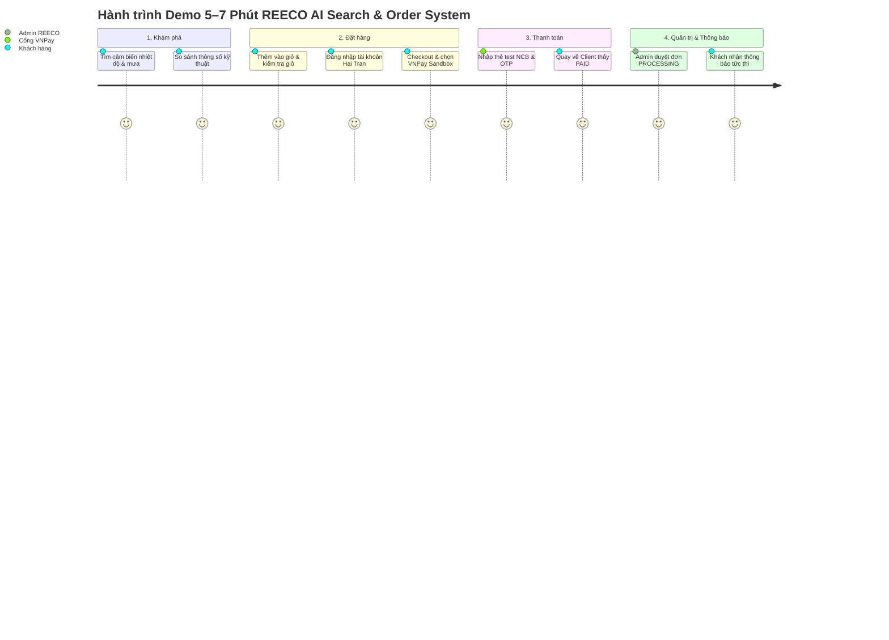

# Kịch Bản Demo Hệ Thống REECO AI Search & Commerce (5–7 Phút)

> **Mục tiêu**: Hướng dẫn chi tiết từng bước thực hiện buổi demo nghiệm thu hoàn chỉnh: Tìm kiếm sản phẩm thông minh → So sánh thông số → Thêm vào giỏ hàng → Đăng nhập khách hàng → Đặt hàng & Thanh toán VNPay Sandbox với thẻ test NCB → Quản trị viên xử lý đơn trên Admin → Khách hàng nhận thông báo trạng thái tức thì.

---

## 1. Thông Tin Chuẩn Bị & Tài Khoản Demo

### 1.1. Môi trường khởi chạy
- **Client (Frontend Khách hàng)**: `http://localhost:5173`
- **Admin Dashboard (Quản trị viên)**: `http://localhost:5174`
- **Backend API (NestJS REST API)**: `http://localhost:3000/api/v1`

### 1.2. Tài khoản đăng nhập
| Vai trò | Tên tài khoản / Email | Mật khẩu | Mục đích |
| :--- | :--- | :--- | :--- |
| **Khách hàng** | `haitran` (hoặc `haitran@example.com`) | `ilovereeco` | Mua hàng, thanh toán, xem thông báo |
| **Quản trị viên** | `admin@reeco.vn` (hoặc `reeco`) | `admin123` (hoặc `ilovereeco`) | Quản lý & chuyển trạng thái đơn hàng |

### 1.3. Thông tin thẻ test VNPay Sandbox (Ngân hàng NCB)
- **Ngân hàng**: NCB (Ngân hàng Quốc Dân)
- **Số thẻ**: `9704198526191432198`
- **Tên chủ thẻ**: `NGUYEN VAN A`
- **Ngày phát hành**: `07/15`
- **Mã xác thực OTP**: `123456`

---

## 2. Kịch Bản Demo Từng Bước (Timeline 5–7 Phút)

---

### Bước 1: Tìm kiếm sản phẩm bằng AI Search (0:00 – 1:00)
- **Địa chỉ**: `http://localhost:5173/`
- **Hành động**:
  1. Tại ô tìm kiếm chính, nhập truy vấn tự nhiên:
     > `"Cảm biến đo nhiệt độ không khí và độ ẩm ngoài trời độ chính xác cao"`
  2. Bấm **Enter** hoặc click biểu tượng Tìm kiếm.
- **Lời thuyết trình**:
  > *"Hệ thống REECO tích hợp mô hình Hybrid Search kết hợp Semantic Embedding và Re-ranking, cho phép người dùng mô tả nhu cầu trắc địa/khí tượng bằng tiếng Việt tự nhiên thay vì phải nhớ chính xác mã SKU kỹ thuật."*
- **Kết quả hiển thị**:
  - Danh sách trả về các dòng cảm biến hàng đầu của Campbell Scientific (như `CS215`, `HMP155A`, `43347 RTD Sensor`).
  - Hiển thị đầy đủ nhãn giá niêm yết bằng VND (`₫`), thông số đo lường chính.

---

### Bước 2: So sánh thông số kỹ thuật (1:00 – 2:00)
- **Hành động**:
  1. Di chuột vào sản phẩm thứ nhất (ví dụ `43347` hoặc `CS215`), click nút **"Add to Compare"** (hoặc biểu tượng cân đối).
  2. Chọn tiếp sản phẩm thứ hai để so sánh.
  3. Bấm vào nút **"Compare (2)"** trên thanh điều hướng Navbar.
- **Lời thuyết trình**:
  > *"Khách hàng khối dự án hoặc chuyên gia nghiên cứu thường cần đặt các cảm biến cạnh nhau để đánh giá dải nhiệt độ hoạt động, độ trôi cảm biến, giao tiếp SDI-12 hoặc Analog. Màn hình Compare đối chiếu từng thông số đo lường giúp ra quyết định mua sắm chuẩn xác."*
- **Kết quả hiển thị**:
  - Bảng so sánh trực quan thông số, dải đo, độ chính xác, cổng kết nối.

---

### Bước 3: Thêm vào giỏ hàng & Đăng nhập (2:00 – 3:00)
- **Hành động**:
  1. Từ bảng so sánh hoặc trang chi tiết sản phẩm, click **"Add to Cart"**.
  2. Click biểu tượng Giỏ hàng trên Navbar để mở Drawer, sau đó click **"View Cart"** (`http://localhost:5173/`).
  3. Tại trang giỏ hàng, điều chỉnh số lượng (ví dụ: tăng lên 2 chiếc), kiểm tra tổng tiền tạm tính tự động cập nhật.
  4. Bấm **"Login"** góc trên Navbar:
     - Chọn tab **Customer**.
     - Nhập `haitran` / `ilovereeco`.
     - Bấm **Sign In**.
- **Lời thuyết trình**:
  > *"Phiên đăng nhập của khách hàng được quản lý an toàn. Khách hàng 'Hai Tran' thuộc đơn vị Trạm Khí tượng Thủy văn đã đăng nhập thành công."*
- **Kết quả hiển thị**:
  - Avatar hoặc tên `Hai Tran` xuất hiện trên Navbar kèm quả chuông thông báo.

---

### Bước 4: Checkout & Thanh toán VNPay Sandbox (3:00 – 4:30)
- **Hành động**:
  1. Bấm **"Checkout"** từ Giỏ hàng.
  2. Trang Checkout hiển thị thông tin giao nhận đã được điền sẵn hoặc khôi phục từ Session:
     - **Full Name**: `Hai Tran`
     - **Email**: `haitran@example.com`
     - **Phone**: `+84 908 123 456`
     - **Address**: `128 Nguyễn Văn Thủ, Phường Đa Kao, Quận 1, TP. Hồ Chí Minh`
  3. **Shipping Method**: Chọn `Standard Delivery` (Phí: `250.000 ₫`).
  4. **Payment Method**: Chọn `Online Payment via VNPAY Sandbox`.
  5. Bấm **"Place Order"**.
  6. Hệ thống chuyển hướng sang cổng thanh toán **VNPay Sandbox**:
     - Tại giao diện VNPay, chọn phương thức: **"Thẻ nội địa và tài khoản ngân hàng"** (hoặc bấm *Quay lại* nếu đang hiện mã QR).
     - Chọn ngân hàng **NCB**.
     - Điền thông tin thẻ test:
       - **Số thẻ**: `9704198526191432198`
       - **Tên chủ thẻ**: `NGUYEN VAN A`
       - **Ngày phát hành**: `07/15`
     - Bấm **Tiếp tục**.
     - Nhập mã OTP xác thực: `123456`.
     - Bấm **Thanh toán**.
- **Lời thuyết trình**:
  > *"Đơn hàng được gửi lên Backend NestJS để tính toán chữ ký số HMAC-SHA512 chuẩn theo thuật toán VNPay RFC-2104. Giá trị đơn hàng và phí ship được tính toán an toàn từ cơ sở dữ liệu, chống hoàn toàn hành vi can thiệp sửa giá từ DevTools."*
- **Kết quả hiển thị**:
  - Cổng VNPay thông báo giao dịch thành công và tự động điều hướng về Client tại `/payment/vnpay-return`.
  - Màn hình hiển thị: **"Payment Successful!"**, mã giao dịch VNPay, trạng thái `PAID`, nút **"View Order Details"**.

---

### Bước 5: Quản trị viên xử lý đơn hàng trên Admin Portal (4:30 – 5:30)
- **Địa chỉ**: `http://localhost:5174/` (mở trên tab hoặc cửa sổ mới)
- **Hành động**:
  1. Đăng nhập tài khoản Admin: `admin@reeco.vn` / `admin123`.
  2. Điều hướng vào menu **"Order Management"** (`/orders`).
  3. Tìm đơn hàng mới nhất vừa đặt (ví dụ: `REECO-1011`):
     - Trạng thái hiện tại: `PROCESSING` (Đã thanh toán).
     - Payment Status: `PAID`.
  4. Bấm vào chi tiết đơn hàng hoặc nút hành động:
     - Chuyển trạng thái sang **"DELIVERING"** (Đang giao hàng) kèm mã vận đơn `VNPOST-EXPRESS-88`.
     - Hoặc cập nhật ghi chú đóng gói kiểm định CO/CQ.
- **Lời thuyết trình**:
  > *"Phía Admin Dashboard sử dụng cơ chế bảo mật Role-based Access Control (RBAC) đồng bộ qua Supabase Auth. Khi Admin thay đổi trạng thái đơn, hệ thống tự động lưu lịch sử Audit Log vào bảng `order_histories` và đồng thời phát sinh thông báo `ORDER_STATUS_CHANGED` cho khách hàng."*

---

### Bước 6: Khách hàng nhận thông báo & Timeline đơn hàng (5:30 – 6:30)
- **Địa chỉ**: Quay lại tab Client `http://localhost:5173/`
- **Hành động**:
  1. Quan sát thanh Navbar: Quả chuông tự động cập nhật số lượng thông báo chưa đọc mới.
  2. Click vào quả chuông hoặc vào **My Account → Notifications**:
     - Xem thông báo mới nhất:
       - *"Thanh toán thành công đơn hàng #1011"* (`PAYMENT_UPDATED`).
       - *"Cập nhật đơn hàng #1011: Đã chuyển sang trạng thái DELIVERING"* (`ORDER_STATUS_CHANGED`).
  3. Bấm vào thông báo để chuyển thẳng đến màn hình **Order Details**:
     - Quan sát mục **Order Status History (Timeline)**:
       - 13:21: Khởi tạo đơn hàng mới.
       - 13:23: Thanh toán thành công qua cổng VNPay (Mã giao dịch: `15691161`).
       - 13:25: Đang vận chuyển (Người cập nhật: Admin).
- **Lời thuyết trình**:
  > *"Giao diện khách hàng được tích hợp cơ chế Session Cache (SWR) hiển thị thông báo tức thì không trễ, đồng thời đồng bộ toàn diện với quy trình xử lý đơn hàng thực tế."*

---

## 3. Các Điểm Kỹ Thuật Đạt Điểm Cao Cần Nhấn Mạnh (Highlights)

1. **Bảo mật thanh toán & Toàn vẹn dữ liệu (Integrity)**:
   - Toàn bộ tổng tiền, đơn giá sản phẩm và phí vận chuyển do server Backend NestJS xác thực. Việc chỉnh sửa payload trong request DevTools sẽ bị từ chối hoặc máy chủ tự tính lại theo bảng giá gốc.
   - Thuật toán ký `calculateSignature` sử dụng chuẩn `crypto.createHmac('sha512', hashSecret)` với key sắp xếp Alphabet và URL encoding chuẩn VNPay.
2. **Xử lý Idempotency & Chống trùng lặp**:
   - Khi khách hàng F5 trang return hoặc VNPay gửi IPN lặp lại, hệ thống không tạo thêm thông báo trùng lặp và không cộng dồn doanh thu.
3. **Cơ chế Lưu Session Client (User Experience)**:
   - Dữ liệu giỏ hàng, thông tin điền form checkout, bộ lọc thông báo và trạng thái trang được lưu trữ trong `sessionStorage`/`localStorage`, giúp người dùng không bao giờ bị mất dữ liệu khi refresh trang.

---

## 4. Bảng Tra Cứu Sự Cố Nhanh Trong Buổi Demo (Troubleshooting)

| Tình huống | Nguyên nhân thường gặp | Cách khắc phục ngay lập tức |
| :--- | :--- | :--- |
| VNPay báo lỗi `code=70` | Sai chữ ký Hash Secret | Đã fix mã hóa ký tự space bằng dấu `+`. Kiểm tra lại file `apps/api/.env` có `VNPAY_HASH_SECRET`. |
| Admin báo lỗi `401 Unauthorized` | Token dev admin hết hạn | Hệ thống đã có cơ chế tự động refresh token trong `api.js`. Chỉ cần F5 lại trang Admin. |
| Không thấy quả chuông thông báo trên Client | Khách hàng chưa đăng nhập | Đăng nhập tài khoản demo `haitran` / `ilovereeco` hoặc kiểm tra `AuthContext`. |
| Thông báo chưa hiển thị ngay | Chu kỳ polling mặc định 30s | Bấm vào biểu tượng quả chuông hoặc F5 trang để kích hoạt nạp ngay từ API/Session Cache. |
