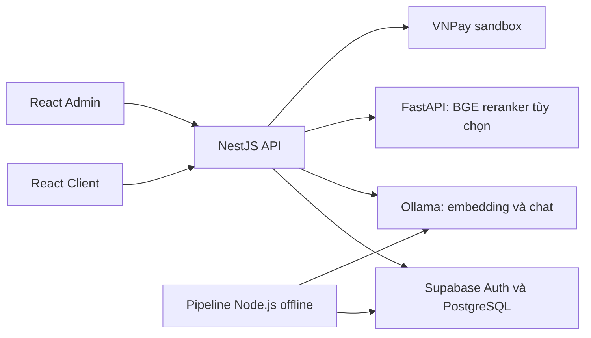
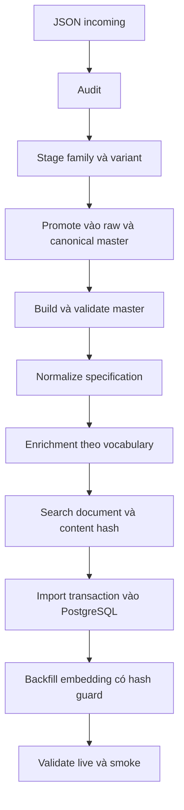
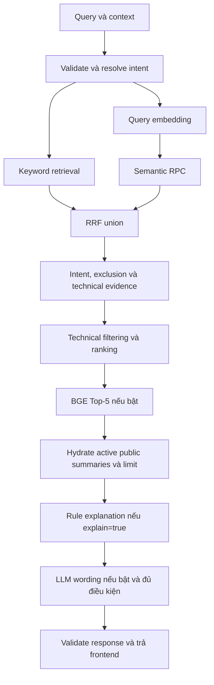

# REECO AI Search — Kiến thức Backend, Pipeline dữ liệu và Tích hợp model

Ngày đối chiếu mã nguồn: **30/10/2026**.

Tài liệu giải thích kiến thức cần hiểu để phát triển, trình bày và bảo vệ đồ án REECO AI Search. Mỗi phần liên hệ khái niệm với cách hệ thống đang triển khai, thay vì chỉ liệt kê công nghệ.

Nội dung dựa trên mã nguồn và artifact trong repository. Ví dụ ghi “minh họa” không phải response vừa chạy. Các bước cài đặt, import, inference và kiểm thử dưới đây là hướng dẫn; **chưa được thực thi trong lần soạn tài liệu này**. Các ngưỡng và giới hạn nêu trong code không tự trở thành cam kết vận hành production.

Đọc theo thứ tự: kiến trúc → kiến thức backend → dữ liệu offline → tìm kiếm online → tích hợp từng model → chạy và kiểm tra. Có thể dùng thêm [100 câu hỏi và trả lời](hoi-dap-backend-du-lieu-ai.md) để luyện phản biện.

## 1. Hệ thống được chia thành những phần nào?

### 1.1. Kiến trúc đang áp dụng



| Thành phần | Trách nhiệm | Vị trí trong repo |
|---|---|---|
| Client | Gửi nhu cầu, context; hiển thị sản phẩm, evidence, giỏ và đơn | `apps/client` |
| Admin | Quản trị giá, đơn, xem lịch sử và báo cáo | `apps/admin` |
| API | Kiểm request/quyền, xử lí nghiệp vụ, điều phối tìm kiếm/model | `apps/api` |
| Shared contracts | Schema Zod, type và cấu trúc dữ liệu dùng chung | `packages/shared` |
| PostgreSQL | Lưu catalog, giá, đơn, specification, search text và vector | `supabase/migrations` định nghĩa schema |
| Supabase Auth | Đăng nhập, user/session và xác minh token | Qua module auth của API |
| Ollama | Phục vụ embedding và model chat trên máy chạy model | Mặc định `127.0.0.1:11434` |
| BGE service | Chấm lại cặp query–candidate, tối đa 5 candidate | `services/reranker`, cổng 8011 |
| Pipeline dữ liệu | Chuẩn bị, kiểm, import và tạo embedding trước khi search | `scripts`, `data` |

Frontend hiện dùng React với `react-scripts`/CRA theo package của hai app. Các mô tả Vite trong tài liệu cũ không phải căn cứ cho cách build hai frontend hiện tại.

### 1.2. Hai luồng phải phân biệt

**Offline** là luồng chuẩn bị dữ liệu: JSON nguồn → dữ liệu chuẩn → tài liệu tìm kiếm → database → vector sản phẩm. “Offline” ở đây nghĩa là ngoài vòng đời request khách hàng; bước import/backfill vẫn có thể gọi database hosted và model qua mạng.

**Online** là luồng phục vụ người dùng: query → validate/context → retrieval → kiểm chứng → xếp hạng → explanation → response. Request tìm kiếm không build lại toàn bộ catalog hoặc tạo lại vector cho mọi sản phẩm.

Phân chia này giúp việc tốn thời gian được chuẩn bị trước, còn mỗi truy vấn chỉ tính phần cần thiết. Nó cũng tạo yêu cầu đồng bộ: dữ liệu nguồn đổi thì document, index và embedding phải được cập nhật tương ứng.

Nguồn: [AppModule](../apps/api/src/app.module.ts), [package.json](../package.json), [checklist demo](demo-ai-search-checklist.md).

## 2. Kiến thức backend và cách áp dụng trong đồ án

### 2.1. HTTP, REST và hợp đồng API

API là thỏa thuận giữa client và server về URL, method, request, response và lỗi. HTTP truyền dữ liệu; nghiệp vụ được backend kiểm tra dù request đến từ UI hay công cụ gọi API trực tiếp.

Ví dụ các đường dẫn hiện có:

| Tác vụ | HTTP | Ý nghĩa |
|---|---|---|
| Xem danh sách | `GET /api/v1/products` | Đọc catalog public, phân trang/lọc |
| Xem chi tiết | `GET /api/v1/products/:productId` | Đọc thông số, media và facet của sản phẩm |
| Tìm kiếm | `POST /api/v1/search` | Nhận query, limit, explain và context có cấu trúc |
| Đăng nhập | `POST /api/v1/auth/login` | Đổi thông tin đăng nhập lấy session |
| Tạo đơn | `POST /api/v1/orders` | Ghi đơn sau kiểm quyền và dữ liệu |
| Sửa giá | `PUT /api/v1/admin/products/:productId/price` | Thay giá có kiểm quyền và audit |
| Tạo URL thanh toán | `POST /api/v1/payments/vnpay/create-url` | Kí yêu cầu thanh toán theo đơn đã lưu |

Search dùng POST để gửi body có context; không phải vì nó cần ghi catalog. Tiền tố `api/v1` được đặt tại bootstrap. Thay contract cần kiểm cả caller frontend, script, fixture và tài liệu, không chỉ sửa controller.

Các mã lỗi thường gặp:

| Mã | Khi áp dụng trong dự án |
|---|---|
| 400 | Input không hợp lệ hoặc điều kiện request không được chấp nhận |
| 401 | Thiếu token hoặc token không hợp lệ/hết hạn |
| 403 | Không có quyền admin, import bị khóa hoặc staging chặn ghi |
| 404 | Không tìm thấy tài nguyên hoặc không cho biết tài nguyên của người khác |
| 409 | Quote giá cũ hoặc trạng thái đơn đã thay đổi |
| 429 | Vượt giới hạn request |
| 503 | Phụ thuộc cần thiết không khả dụng |

Không phải mọi lỗi model đều làm request thất bại: nếu còn đường thay thế hợp lệ, search vẫn có thể trả 200 với mode fallback hoặc explanation theo rule.

Nguồn: [bootstrap](../apps/api/src/main.ts), [API contract](api-contract.md), [SearchController](../apps/api/src/modules/search/search.controller.ts).

### 2.2. Module, controller, service và repository

| Lớp | Kiến thức | Cách dùng trong REECO |
|---|---|---|
| Module | Gom một miền chức năng và khai báo dependency | Products, Orders, Auth, Search, Embeddings |
| Controller | Chuyển HTTP thành lời gọi ứng dụng | Nhận body, áp guard/pipe, gọi service |
| Service | Chứa quy tắc và điều phối nghiệp vụ | Tính tiền, kiểm transition, hợp retrieval |
| Repository | Gom thao tác đọc/ghi dữ liệu | Đọc giá, tìm đơn, lấy product summary |
| Provider | Thành phần được Nest khởi tạo và inject | SupabaseService, embedding provider |
| RPC | Hàm SQL được gọi từ API | Keyword/semantic search, cập nhật giá và audit |

Ví dụ luồng tìm kiếm:

```text
SearchController
  → ZodValidationPipe(SearchRequestSchema)
  → SearchService
  → HybridSearchService / TechnicalMatchService / RerankerService
  → ProductsService / Supabase RPC / Ollama / FastAPI
```

Cấu trúc không hoàn toàn đồng nhất: một số search adapter gọi RPC trực tiếp qua SupabaseService. Vì vậy không mô tả mọi module đều buộc có một repository riêng. Điều cần giữ là HTTP không tự chứa toàn bộ nghiệp vụ và quy tắc dùng chung không bị sao chép vào nhiều caller.

### 2.3. Dependency Injection — truyền dependency thay vì tự tạo khắp nơi

NestJS đọc provider trong module và truyền dependency qua constructor. Ví dụ `SearchController` nhận `SearchService`; các test có thể cung cấp dependency giả để kiểm logic mà không gọi model/DB thật.

Với embedding, dự án đã có token `EMBEDDING_PROVIDER`. Đoạn cấu trúc rút gọn từ module hiện tại:

```typescript
{
  provide: EMBEDDING_PROVIDER,
  useFactory: () => {
    const embedding = configuration().embedding;
    return new OllamaEmbeddingProvider({
      ...embedding,
      timeoutMs: configuration().search.embeddingTimeoutMs,
    });
  },
}
```

Đây là đoạn giải thích tương đương, không phải file mới cần thêm. Điểm cần hiểu: cấu hình provider nằm tại nơi khởi tạo; service sử dụng interface để gọi embedding. Timeout của query online được lấy từ cấu hình search, không mặc nhiên dùng timeout backfill dài hơn.

Nguồn: [EmbeddingsModule](../apps/api/src/modules/embeddings/embeddings.module.ts), [EmbeddingProvider](../apps/api/src/ai/embedding.provider.ts), [EmbeddingsService](../apps/api/src/modules/embeddings/embeddings.service.ts).

### 2.4. TypeScript type khác runtime validation

TypeScript giúp phát hiện lỗi khi viết/build code, nhưng JSON người dùng gửi tới server không tự được bảo vệ bởi type. Zod kiểm giá trị thực tại thời điểm nhận request.

Search hiện kiểm query dài tối đa 500 kí tự, chứa chữ/số; limit trong 1–100; context có tối đa 5 product ID. Sai thì pipe trả 400 và trường lỗi. Schema strict từ chối trường không khai báo; riêng một số order schema chọn bỏ trường lạ để tương thích caller. Không suy rộng chính sách strict của search cho mọi endpoint.

Ví dụ request hợp lệ về cấu trúc:

```json
{
  "query": "cảm biến đo độ ẩm đất hỗ trợ SDI-12 hoạt động ở -40°C",
  "limit": 5,
  "explain": true
}
```

Hợp lệ về cấu trúc chưa có nghĩa có sản phẩm đáp ứng. Backend còn phải hiểu intent, tìm candidate và đối chiếu evidence. Search response cũng được parse bằng schema trước trả ra; không khẳng định mọi response của toàn bộ app đều runtime-validate giống nhau.

Nguồn: [shared API schemas](../packages/shared/src/schemas/api-contract.ts), [Zod pipe](../apps/api/src/common/pipes/zod-validation.pipe.ts), [order DTO](../apps/api/src/modules/orders/dto/create-order.dto.ts).

### 2.5. Authentication và authorization

**Authentication** trả lời “request này của ai?”. Frontend gọi auth API; Supabase Auth cấp session. `SupabaseAuthGuard` lấy Bearer token và dùng Supabase xác minh user.

**Authorization** trả lời “người đó được làm gì?”. `AdminGuard` kiểm `app_metadata.role`, còn nghiệp vụ đơn/thông báo kiểm customer ID hoặc quyền admin. Biết một order ID không đồng nghĩa có quyền đọc/hủy order đó.

```text
Authorization: Bearer <access_token>
       ↓
SupabaseAuthGuard xác minh user
       ↓
AdminGuard hoặc kiểm quyền sở hữu tài nguyên
       ↓
Service thực hiện nghiệp vụ
```

Role không lấy từ body do khách gửi hoặc `user_metadata.role`. Login và refresh dùng session client riêng: nếu đăng nhập trên Supabase service-role client dùng chung, session khách có thể thay auth context của các thao tác DB tiếp theo. `createSessionClient()` tách việc đó khỏi client hệ thống.

Register hiện tạo customer qua admin API và đặt `email_confirm: true`; chưa phải luồng khách phải bấm link tự xác minh email.

Nguồn: [AuthService](../apps/api/src/modules/auth/auth.service.ts), [SupabaseService](../apps/api/src/database/supabase/supabase.service.ts), [auth guard](../apps/api/src/auth/supabase-auth.guard.ts), [admin guard](../apps/api/src/auth/admin.guard.ts).

### 2.6. RLS, service-role và bảo vệ dữ liệu

RLS áp chính sách đọc/ghi ở cấp hàng trong PostgreSQL. Catalog public chỉ cho đọc dữ liệu active theo policy; commerce được khóa truy cập trực tiếp của anon/authenticated và đi qua API.

`service_role` ở backend vượt RLS, nên backend vẫn phải kiểm quyền từng tài nguyên. Bật RLS không sửa được lỗi API quên lọc customer ID. Cần phân biệt quyền theo vai trò với quyền sở hữu một bản ghi.

Frontend chỉ nhận cấu hình public như API URL. Service-role key, database password và VNPay hash secret ở phía server; không đưa vào `REACT_APP_*`, response hoặc tài liệu ví dụ. `.gitignore` không chứng minh secret chưa từng xuất hiện trong Git history.

Nguồn: [catalog policy](../supabase/migrations/20261010000000_restrict_authenticated_catalog_read.sql), [commerce migration](../supabase/migrations/20261001000000_commerce_foundation.sql).

### 2.7. Bất đồng bộ, xử lí song song và timeout

`async/await` cho phép code chờ I/O mà không viết theo chuỗi callback. Nó không tự làm inference nhanh hơn hoặc biến code CPU nặng thành xử lí song song.

Hybrid retrieval chạy keyword và semantic bằng `Promise.allSettled`: cả hai đều được quan sát, một nhánh lỗi vẫn có thể dùng nhánh còn lại. Nếu dùng một chuỗi await tuần tự thì thời gian chờ thường cộng lại; nếu dùng `Promise.all` và xử lí lỗi không phù hợp thì một lỗi có thể làm mất kết quả nhánh còn tốt.

Timeout cần hủy I/O khi có thể, không chỉ dừng chờ. Dự án có AbortController/AbortSignal và helper deadline, nhưng chưa có cơ chế đã xác nhận truyền tín hiệu client disconnect xuyên toàn bộ pipeline. Một request nhiều thành phần có thể gọi nhiều search con; cần tính ngân sách tổng, không chỉ timeout mỗi call.

### 2.8. Transaction, idempotency, optimistic concurrency và snapshot

| Khái niệm | Ý nghĩa | Ví dụ trong REECO |
|---|---|---|
| Transaction | Nhiều thay đổi cùng commit hoặc rollback trong phạm vi được gom | Import catalog dùng `sql.begin`; cập nhật giá và trigger audit |
| Idempotency | Lặp cùng tác vụ không tạo thêm tác dụng nghiệp vụ ngoài ý muốn | Import cùng hash; callback paid được gửi lại |
| Optimistic concurrency | Chỉ ghi nếu trạng thái/phiên bản vẫn như lúc đọc | Update order có điều kiện status; ghi vector có hash/version guard |
| Snapshot | Lưu giá trị ở thời điểm nghiệp vụ xảy ra | Unit price, model, tên sản phẩm trong order item |

Ví dụ giá thay đổi: server lấy giá DB để tính tiền, so `expected_unit_price` nếu caller gửi, lệch trả 409; order cũ giữ snapshot. Client không được quyết định tổng tiền chỉ bằng cách gửi một con số.

Phạm vi transaction phải nói chính xác. Import catalog và audit giá có transaction riêng; tạo order hiện ghi nhiều call và xóa order bù nếu insert item lỗi. History/notification của order/payment được ghi riêng, lỗi có thể chỉ được log. Chống callback lặp không đồng nghĩa toàn bộ luồng đạt atomic hoặc exactly-once khi process chết giữa chừng.

Nguồn: [importer](../scripts/supabase/import-data-foundation.mjs), [price audit](../supabase/migrations/20261014000000_product_price_history.sql), [OrdersService](../apps/api/src/modules/orders/orders.service.ts), [OrdersRepository](../apps/api/src/modules/orders/orders.repository.ts).

### 2.9. State machine và xác thực thanh toán

Trạng thái đơn là một state machine: từ mỗi trạng thái chỉ có một tập bước chuyển được cho phép. Backend kiểm transition, quyền người gọi và trạng thái thực tại lúc ghi để tránh callback ghi đè thao tác hủy đồng thời.

VNPay URL được kí theo số tiền của đơn đã lưu. Verify/IPN kiểm HMAC-SHA512, txn ref, số tiền và trạng thái giao dịch trước cập nhật. URL quay về browser không tự chứng minh đã thanh toán. Callback lặp được nhận biết; đơn đã hủy không bị tự chuyển lại processing. Hoàn tiền/đối soát tự động toàn diện chưa phải chức năng được chứng minh trong repo.

Nguồn: [order constants](../apps/api/src/modules/orders/orders.constants.ts), [VNPayService](../apps/api/src/modules/orders/vnpay.service.ts).

### 2.10. CORS, rate limit, log và health

CORS quy định origin nào được browser cho gọi API; đây không phải cơ chế xác thực hay thay thế guard. Rate limit hiện bảo vệ search, login và register theo IP; dữ liệu đếm trong memory của một process, chưa chia sẻ cho nhiều instance.

Log giúp phân biệt retrieval degraded, reranker fallback và explanation accepted/timeout. Không log token, mật khẩu hoặc toàn bộ hồ sơ khách để gỡ lỗi. `/health` của Nest hiện là liveness/cấu hình, không kiểm DB/model thật; phải dùng smoke và validator để xác nhận search hoạt động.

Nguồn: [bootstrap](../apps/api/src/main.ts), [rate limiter](../apps/api/src/common/middleware/rate-limit.middleware.ts), [health controller](../apps/api/src/modules/health/health.controller.ts).

## 3. Database: dữ liệu quan hệ, JSON và chỉ mục

### 3.1. Vì sao tách nhiều bảng?

| Bảng | Dữ liệu giữ | Lí do tách |
|---|---|---|
| `products` | Identity, model, taxonomy, status | Điểm tham chiếu chung cho catalog |
| `product_specifications` | Canonical key, normalized value, raw reference | Một sản phẩm có nhiều thông số, cần truy vết/so khớp |
| `product_documents` | Search document và text đã tổng hợp | Lưu bản dữ liệu phục vụ retrieval/explanation |
| `product_search_index` | FTS text/index, vector và metadata | Phục vụ truy xuất, quản lí vòng đời embedding |
| `product_media` | Ảnh/URL/metadata | Tránh lặp thông tin media trong mỗi thông số |
| `product_prices` | Giá hiện hành | Có thể đổi giá mà không sửa nội dung kỹ thuật/vector |
| `product_price_history` | Giá cũ/mới, actor, thời gian | Audit các lần thay đổi |
| `orders`, `order_items` | Giao dịch và snapshot từng dòng hàng | Bảo toàn lịch sử khi giá/catalog hiện tại đổi |
| `order_status_history` | Diễn biến trạng thái | Truy vết nghiệp vụ |
| `notifications` | Thông báo theo khách | Lưu trạng thái đọc và liên kết đơn |

Khóa chính định danh bản ghi; khóa ngoại bảo vệ liên kết; unique constraint chống trùng; check constraint giữ quy tắc như quantity hợp lệ hoặc tổng tiền bằng subtotal cộng shipping. Kiểm ở DB là lớp bổ sung cho validation server.

Thông số không có cùng hình dạng nên có phần JSON/JSONB cho giá trị và provenance, nhưng identity và quan hệ vẫn là dữ liệu có cấu trúc. “Dùng JSONB” không đồng nghĩa bỏ schema: Zod, rule pipeline và DB constraint vẫn cần phối hợp.

### 3.2. FTS và pgvector là hai cơ chế khác nhau

FTS tạo `tsvector` từ search text bằng cấu hình `simple`; GIN index hỗ trợ tra từ khóa. RPC dùng `websearch_to_tsquery` và lexical ranking. Keyword adapter hiện còn có nhánh mở rộng concept khi thưa kết quả, gợi ý model và bổ sung literal specification hit; vì vậy không mô tả keyword runtime chỉ có đúng một SQL call.

pgvector lưu vector và dùng cosine distance cho ngữ nghĩa. Migration hiện có cột `vector(1536)` nhưng chưa tạo HNSW/IVFFlat; truy vấn dùng exact scan. Có pgvector không tự nghĩa đã có ANN index.

Điểm cosine, lexical và RRF không phải xác suất “sản phẩm đúng”. Khi technical policy đổi thứ tự, danh sách cũng không nhất thiết giảm dần theo điểm RRF ban đầu.

### 3.3. RPC và migration

RPC là gọi một hàm SQL đã khai báo, ví dụ `search_products_keyword`, `search_products_semantic`, `set_product_price`. Hàm thực thi gần dữ liệu, phù hợp các phép tìm kiếm hoặc thay đổi cần gom trong DB. Semantic RPC giới hạn execute cho service-role theo migration.

Migration là lịch sử thay đổi schema/policy/function. Phải áp đúng version trên DB mục tiêu; file local tồn tại không chứng minh hosted đã áp dụng. PGlite harness giúp thử một phần SQL nhưng không thay thế kiểm pgvector/event trigger trên Supabase đầy đủ.

Nguồn: [foundation migration](../supabase/migrations/20260915081333_data_foundation_v1.sql), [semantic migration](../supabase/migrations/20260916080205_step7_semantic_search_foundation.sql), [keyword adapter](../apps/api/src/modules/search/keyword-search.service.ts), [database notes](database.md).

## 4. Pipeline dữ liệu: đầu vào, xử lí và đầu ra từng giai đoạn



| Giai đoạn | Input | Output chính | Kiểm tra quan trọng |
|---|---|---|---|
| Incoming audit | JSON mới, raw/master đang có | Report lỗi/xung đột | Cấu trúc, ID, identity, trùng dữ liệu |
| Stage | Incoming và metadata curation | Family staged và variants | Representative và khác biệt phiên bản |
| Promote | Staged, master/source, raw | Kế hoạch hoặc cập nhật raw/master | Collision, thiếu canonical field, nguồn bị mất |
| Master | Canonical/source và raw inventory | Product master và report mapping | ID/model/taxonomy, active/review |
| Normalize | Master, raw và mapping | Specification theo product ID | Kiểu, đơn vị, range, raw reference |
| Enrich | Master, normalized và vocabulary | Measurements/capabilities/applications/keywords | Evidence và protocol không bị gán sai |
| Build document | Master, enriched, normalized | Search document, search text, hash | Coverage, schema, hash, nội dung phủ định |
| Import | Artifact đã validate | Các bảng catalog/search | Transaction, upsert, invalidation vector |
| Backfill | Search text active trong DB | Vector và model/version/time | Đúng nguồn, đúng chiều, không ghi vector stale |
| Validate/smoke | DB và API/model thực | Report trạng thái và ca thử | Coverage, metadata, kết quả/fallback |

### 4.1. Giai đoạn 1 — Audit dữ liệu đầu vào

Đầu vào là JSON catalog đã được chuẩn bị; pipeline không phải bộ crawl/OCR/PDF extractor tổng quát. Incoming có thể là raw document hoặc wrapper chứa raw/canonical data.

Audit kiểm `products`, product ID, model, specifications, ID đã tồn tại và xung đột canonical/raw. Một JSON parse được vẫn có thể sai model hoặc thiếu taxonomy, nên kiểm cú pháp chưa đủ.

```powershell
npm run audit:raw-incoming
```

Lệnh đọc dữ liệu và ghi report local, không import DB. Report chính: `data/reports/raw-incoming-audit.json`.

### 4.2. Giai đoạn 2 — Stage product family và variant

Stage gom bản ghi liên quan, chuẩn hóa ID, chọn representative theo dữ liệu/curation và giữ variant cùng provenance. Mục tiêu là tránh coi cùng một sản phẩm là nhiều sản phẩm độc lập hoặc gán thông số biến thể A sang B.

```powershell
npm run stage:raw-incoming
```

Output ở `data/raw-staged` và staging report. Đây là ghi artifact local. Review representative, taxonomy và các khác biệt về giao tiếp/cấu hình trước bước promote; representative không có nghĩa mọi specification đều đúng cho mọi variant.

### 4.3. Giai đoạn 3 — Promote vào raw và canonical master

Promote kiểm staged identity, model collision, vị trí raw và các trường canonical bắt buộc. Chế độ mặc định tạo kế hoạch/report; chế độ write mới thay raw/master/source.

```powershell
# Xem kế hoạch, chưa sửa raw/master.
npm run promote:raw-incoming

# Ghi raw/master sau khi đã kiểm kế hoạch.
npm run promote:raw-incoming:write
```

Promote không tự chạy normalization, enrichment, document hoặc DB import. Sau thay đổi phải đi tiếp đủ chuỗi; không dừng tại “file raw đã thêm”.

### 4.4. Giai đoạn 4 — Product master và trạng thái active/review

Master giữ identity chuẩn, tên/model, taxonomy, URL/media và trạng thái. Builder đọc canonical master hiện có, source metadata và raw inventory để đối chiếu; nó không tự biến mọi raw record thành một canonical product mới.

`active` cho biết đủ điều kiện đưa vào luồng searchable theo rule dữ liệu; `review` là cần xử lí trước khi phục vụ. Không ép active chỉ để kết quả có nhiều sản phẩm hơn.

```powershell
npm run build:product-master
npm run validate:product-master
```

Nguồn số liệu là [master report](../data/reports/product-master-report.json), không lấy số lượng trong đoạn README lịch sử làm constraint cố định. Snapshot đã lưu có 89 active; chưa truy vấn DB live để xác nhận lại trong tài liệu này.

### 4.5. Giai đoạn 5 — Chuẩn hóa specification

Mục đích là chuyển những giá trị hiểu chắc sang number/range/boolean/list/protocol, thống nhất canonical key/quantity/unit và giữ text/raw reference để truy vết. “Chuẩn hóa specification” khác chuẩn hóa quan hệ database: một bên diễn giải giá trị kỹ thuật, một bên tổ chức bảng để giảm lặp và giữ quan hệ.

Ví dụ rút gọn từ artifact CS655 đã có trong repo:

```json
{
  "product_id": "CSI_CS655",
  "name_raw": "Operating Temperature Range",
  "value_raw": "-50° to +70°C",
  "type": "range",
  "normalized": {
    "type": "range",
    "min_value": -50,
    "max_value": 70,
    "unit": "°C",
    "qualifier": null
  },
  "canonical_key": "operating_temperature_range",
  "quantity_kind": "temperature",
  "raw_ref": {
    "file": "data/raw/CS616_CS650_CS655.json",
    "product_index": 2,
    "spec_index": 7,
    "source_rows": [12]
  }
}
```

Từ đây code có thể kiểm mức −40°C nằm trong khoảng −50 đến 70°C. Cùng sản phẩm còn có `soil_temperature_range`; trùng con số không làm hai key trở thành cùng một ý nghĩa. Không dùng operating range để chứng minh đo nhiệt độ nước.

Nếu giá trị chưa parse chắc, giữ `type: text`, `normalized: null`, `value_raw` và nguồn thay vì ép thành số. Artifact normalization và response DB/API có hình dạng khác nhau; không copy nguyên JSON artifact rồi cho rằng đó là response endpoint.

```powershell
npm run build:spec-normalization
npm run validate:spec-normalization
```

Snapshot [normalization report](../data/reports/spec-normalization-report.json) ghi 3.277 specification: 1.012 có cấu trúc, 2.265 giữ text. Giữ text có chủ đích không đồng nghĩa mất dữ liệu hoặc parse thất bại toàn bộ; ngược lại PASS cũng không chứng minh mọi đơn vị đã được hiểu.

### 4.6. Giai đoạn 6 — Semantic enrichment

Enrichment dùng rule và vocabulary Việt–Anh để tạo facet giúp hiểu/tra cứu: đại lượng đo, vai trò, capability, application, protocol, keyword và evidence nguồn. Ví dụ “độ ẩm đất”, “soil moisture” và “volumetric water content” được liên hệ theo từ vựng miền và dữ liệu sản phẩm.

```powershell
npm run build:semantic-enrichment
npm run validate:semantic-enrichment
```

Đầu ra ở `data/enriched/products`. Bước này hiện không giao toàn quyền cho chat model tự suy ra thông số. Application liên quan giúp retrieval, nhưng một nhãn ứng dụng không tự chứng minh dải đo, độ chính xác hay tương thích điện/giao tiếp. Protocol phủ định cần được giữ khác protocol hỗ trợ.

Nguồn: [enrichment engine](../scripts/semantic-enrichment/lib.mjs), [vocabulary](../data/ontology/semantic-vocabulary.json).

### 4.7. Giai đoạn 7 — Search document và content hash

Search document hợp identity, taxonomy, measurements, applications, capabilities, protocols, alias và một số specification quan trọng thành cấu trúc tìm kiếm. Builder tạo `search_text_en`, `search_text_vi`, `search_text` và hash nội dung.

```powershell
npm run build:search-documents
npm run validate:search-documents
```

`content_hash` là dấu vân tay SHA-256 của nội dung canonical theo builder, giúp phát hiện thay đổi. Hash không chứng minh nội dung đúng sự thật; nó chỉ giúp biết bản hiện tại có giống bản đã xử lí không. Một nội dung sai vẫn có hash hoàn toàn hợp lệ.

Search text không chứa toàn bộ raw specification. Vì vậy runtime còn đọc specification có cấu trúc/literal evidence riêng; chỉ embed search text không thay thế việc kiểm thông số từ nguồn phù hợp.

Nguồn: [document builder](../scripts/search-documents/lib.mjs), [CS655 search document](../data/search-documents/CSI_CS655.json).

### 4.8. Giai đoạn 8 — Import vào PostgreSQL

Importer kiểm artifact/schema/hash trước kết nối DB rồi upsert catalog theo transaction. Cùng input không đổi thì document/index không bị ghi lại không cần thiết. Khi source hash hoặc index version đổi, index cập nhật text và xóa embedding cùng metadata để tránh vector cũ đi với nội dung mới.

```powershell
# Kiểm nguồn, không kết nối DB; có ghi report local.
npm run supabase:dry-run

# Ghi database được cấu hình: chỉ chạy sau kiểm tra target và dữ liệu.
npm run supabase:import

# Đọc DB để đối chiếu sau import.
npm run supabase:validate
```

Transaction này không bao phủ các file build trước đó hay embedding tạo sau đó. Validation sau import có thể phát hiện lỗi sau khi transaction đã commit; không tự hoàn tác một đợt import đã xong.

Importer hiện có thao tác dọn dữ liệu review và nhánh xóa product review; không tự xóa mọi ID vắng khỏi master. Khi ngừng bán/xóa sản phẩm cần kiểm cả active DB và foreign key từ order item, bảo toàn lịch sử. Xóa file local không đủ chứng minh sản phẩm đã ngừng phục vụ.

Nguồn: [import-data-foundation.mjs](../scripts/supabase/import-data-foundation.mjs).

### 4.9. Giai đoạn 9 — Backfill embedding

Backfill đọc active product có search text trong `product_search_index`, bỏ qua vector đã current, gọi Ollama theo batch và ghi vector + metadata. Input duy nhất để embed sản phẩm là search text đã chuẩn bị, không gửi nguyên raw JSON hoặc giá/đơn hàng.

```powershell
# Mặc định chỉ ghi report dry-run, không gọi DB/model.
npm run embeddings:backfill

# Thực thi gọi model và ghi vector vào DB.
npm run embeddings:backfill -- --execute

# Đọc Supabase thật để kiểm coverage/vector/model/version.
npm run embeddings:validate
```

Ghi vector có điều kiện source hash/index version còn khớp bản đã đọc và product vẫn active. Nếu catalog đổi trong lúc model đang chạy, vector cũ không được ghi đè bản mới. Đây là optimistic concurrency áp dụng cho dữ liệu AI.

Nguồn: [backfill](../scripts/create-embeddings/backfill.mjs), [backfill logic](../scripts/create-embeddings/lib.mjs), [validator live](../scripts/create-embeddings/validate.mjs).

### 4.10. Giai đoạn 10 — Audit và xác nhận bản dữ liệu sử dụng

Kiểm source/master/specification/document trước, rồi kiểm DB coverage, hash và metadata embedding; cuối cùng gọi search smoke qua API thực. `supabase:audit-specifications` đọc DB thật để so normalized/raw, có ích khi cần chứng minh một con số trên API xuất phát từ đâu.

Không gộp “report local PASS”, “DB đã đồng bộ” và “API đang chạy code mới” thành một trạng thái. Mỗi bước cần đúng môi trường, phiên bản và bằng chứng riêng.

## 5. Dữ liệu chạy qua request tìm kiếm như thế nào?

### 5.1. Luồng chính



Đây là luồng search thông thường. Câu hỏi giải thích model đã chọn có thể lấy evidence trực tiếp theo ID; nhu cầu nhiều thành phần có thể tách thành nhiều search con. Không khẳng định mọi request đều chạy đủ từng stage hoặc gọi đúng một lần model.

### 5.2. Resolve query và context

Context hiện có `base_query`, `previous_query`, `product_ids`. Resolver dùng rule nhận dạng follow-up; backend trả `resolved_query` và `context_applied` để UI thể hiện câu đã hiểu.

Ví dụ: “cảm biến đo độ ẩm đất” → “chỉ lấy loại hỗ trợ SDI-12”. Backend giữ nhu cầu nền và thêm điều kiện giao thức; không coi mọi lượt là một cuộc hội thoại do LLM tự nhớ. Context do browser gửi phải được validate, còn evidence sản phẩm phải tải lại từ DB active.

### 5.3. Keyword, semantic và RRF

Keyword tìm từ/mã và có các bổ sung concept/literal/model theo adapter; semantic tạo vector query rồi RPC chọn sản phẩm có embedding tương thích. Với hai rank, RRF tính:

```text
RRF(product) = tổng 1 / (K + rank_nguồn)
K mặc định = 60

Ví dụ minh họa:
Product A: keyword rank 1, semantic rank 3
RRF(A) = 1/61 + 1/63 ≈ 0,03227

Product B: chỉ có semantic rank 1
RRF(B) = 1/61 ≈ 0,01639
```

Đây là ví dụ cách tính, không phải số đo một request vừa chạy. RRF dùng rank nên không cần xem lexical score và cosine là cùng thang. K=60 là baseline trong config, chưa có bằng chứng là tối ưu cho mọi catalog.

Candidate depth mặc định 20 mỗi nguồn, được nâng ít nhất bằng limit request và giới hạn tối đa 100. Sản phẩm ngoài candidate union không được reranker tự tìm thêm.

### 5.4. Kiểm chứng kỹ thuật và ba trạng thái

| Trạng thái | Ý nghĩa | Ví dụ |
|---|---|---|
| MATCH | Có evidence phù hợp xác nhận yêu cầu | Operating range chứa mức query yêu cầu |
| MISMATCH | Evidence đúng loại cho thấy không đáp ứng | Range không bao phủ yêu cầu theo rule hỗ trợ |
| UNKNOWN | Thiếu, mơ hồ hoặc chưa hỗ trợ diễn giải | Không có dữ liệu xác nhận USB |

Parser v2 nhận protocol và một số biểu thức đơn vị/nhiệt độ; matcher dùng canonical key đúng nghĩa. RS-485 không tự là Modbus RTU, Ethernet không tự là Modbus TCP, nhiệt độ vận hành không tự là nhiệt độ đo.

Policy hiện tại yêu cầu các protocol và temperature high-confidence đang áp dụng phải MATCH trong nhánh lọc thông thường. Không lấy mô tả cũ “mọi UNKNOWN đều được giữ” để giải thích code hiện tại. Nhánh giải thích model được chọn vẫn có thể giữ partial match và nêu unconfirmed/mismatch.

### 5.5. Ranking và explanation

Technical ranking ưu tiên exact identity, số điều kiện thỏa, protocol xác nhận, trạng thái nhiệt độ rồi retrieval rank/tie-break; có lọc hard mismatch. BGE tùy chọn chỉ đổi prefix còn hợp lệ. Sau đó hydration loại sản phẩm không còn public active trước áp final limit.

Explanation lấy evidence và trạng thái yêu cầu, tạo text theo rule rồi mới thử model chat. Semantic similarity chỉ giúp tìm liên quan, không được dùng thay chứng cứ một thiết bị thực sự hỗ trợ giao thức hoặc đo được một đại lượng.

Nguồn: [SearchService](../apps/api/src/modules/search/search.service.ts), [HybridSearchService](../apps/api/src/modules/search/hybrid-search.service.ts), [RRF service](../apps/api/src/modules/search/search-score.service.ts), [technical ranking](../apps/api/src/modules/search/technical-ranking.service.ts), [conversation](../apps/api/src/modules/search/conversation-query.ts), [parser expansion](parser-expansion-2026-10-14.md).

## 6. Ba model: nhiệm vụ, ranh giới và dữ liệu nhận vào

| Thành phần | Model áp dụng | Input | Output | Đường gọi |
|---|---|---|---|---|
| Embedding | `qwen3-embedding:4b` | Search text hoặc query | Vector 1536 chiều | Ollama `/api/embed` |
| Reranking | `BAAI/bge-reranker-v2-m3` | Query và evidence text của tối đa 5 candidate | Score và thứ tự | Nest → FastAPI `/rerank` |
| Explanation | `qwen3:4b-instruct-2507-q4_K_M` dùng trong các thử nghiệm của dự án | Query, evidence, requirements và wording examples | JSON text theo từng index | Ollama `/api/chat` |

Trong báo cáo có thể gọi chung là tích hợp model AI, nhưng cần phân biệt BGE cross-encoder với chat LLM. Không đưa query vào một chat model rồi coi nó đã thay thế embedding, retrieval và kiểm chứng kỹ thuật.

Đồ án đang **inference bằng model đã có**. Import catalog/backfill không huấn luyện hoặc fine-tune trọng số. Chưa có bằng chứng fine-tuning trên dữ liệu REECO.

Luồng lấy evidence rồi diễn đạt có đặc điểm retrieval-grounded; không nên mô tả thành chatbot RAG sinh tư vấn tự do hoặc hệ thống tự đọc mọi PDF. LLM hiện bị ràng buộc wording và không tự quyết giao dịch, giá hoặc quyền.

## 7. Tích hợp model embedding qua Ollama

### 7.1. Kiến thức cần hiểu

Embedding là một mảng số biểu diễn text. Query và document cần cùng không gian model/phiên bản/chiều để so sánh có ý nghĩa. Đổi model mà giữ vector cũ không phải nâng cấp hợp lệ.

Cosine similarity đo hướng tương đối của hai vector. Database RPC hiện xếp theo cosine distance, còn similarity được biến đổi/chặn theo contract của RPC; không gọi nó là xác suất đáp ứng yêu cầu.

### 7.2. Cấu hình đang dùng

Đặt tại `apps/api/.env` trong môi trường chạy tương ứng; đây là ví dụ cấu hình không chứa secret:

```dotenv
EMBEDDING_PROVIDER=ollama
OLLAMA_BASE_URL=http://127.0.0.1:11434
EMBEDDING_MODEL=qwen3-embedding:4b
EMBEDDING_DIMENSIONS=1536
EMBEDDING_VERSION=ollama-qwen3-embedding-4b-1536-v1
EMBEDDING_BATCH_SIZE=8
OLLAMA_EMBEDDING_TIMEOUT_MS=180000
SEARCH_EMBEDDING_TIMEOUT_MS=10000
```

Ollama là dịch vụ inference; file TypeScript không chứa trọng số model. Backfill/warmup có ngân sách dài 180 giây, module online khởi tạo provider với 10 giây mặc định. Không nâng timeout online lên vài phút để che cold start.

### 7.3. Hợp đồng gọi model

Provider hiện gửi payload có dạng sau; text là ví dụ minh họa:

```json
{
  "model": "qwen3-embedding:4b",
  "input": "soil moisture sensor supporting SDI-12",
  "dimensions": 1536
}
```

`POST /api/embed` trả object có `embeddings`: một vector cho mỗi input. Provider kiểm số lượng vector, đúng 1536 chiều và mọi phần tử hữu hạn; không chấp nhận array sai shape chỉ vì HTTP 200. Backfill có thể gửi mảng text để xử lí theo batch.

### 7.4. Gắn vào NestJS và database

```text
EmbeddingsModule đăng kí EMBEDDING_PROVIDER
  → EmbeddingsService.embedQuery(text)
  → OllamaEmbeddingProvider.embed(text)
  → POST Ollama /api/embed
  → validate vector
  → SemanticSearchService gọi search_products_semantic
```

RPC nhận vector query, required model/version và limit; chỉ dùng row active có metadata khớp. Index row lưu vector, `embedding_model`, `embedding_dimensions`, `embedding_version`, `embedded_at` và nguồn hash/version. Live validator còn kiểm vector khác vector toàn 0 và coverage bằng số active.

Nếu embedding lỗi/timeout, semantic path lỗi; hybrid dùng keyword khi keyword vẫn thành công. Nếu cả hai nguồn lỗi thì trả 503. Mất model không có nghĩa API được phép bịa vector hoặc trộn một model dự phòng khác vào index cũ.

Nguồn: [provider](../apps/api/src/ai/ollama-embedding.provider.ts), [embedding module](../apps/api/src/modules/embeddings/embeddings.module.ts), [semantic adapter](../apps/api/src/modules/search/semantic-search.service.ts), [semantic migration](../supabase/migrations/20260916080205_step7_semantic_search_foundation.sql).

## 8. Tích hợp BGE reranker qua FastAPI

### 8.1. Tại sao có service Python riêng?

BGE dùng Transformers/PyTorch để chấm cặp query–document. NestJS gọi HTTP đến FastAPI, không tự tải checkpoint Python trong process Node. Service load model một lần, warmup, dùng CUDA khi có hoặc CPU, và trả status readiness.

Model/revision hiện được ghim:

```text
BAAI/bge-reranker-v2-m3
953dc6f6f85a1b2dbfca4c34a2796e7dde08d41e
```

Revision cố định giúp biết đúng checkpoint đã được benchmark. Chỉ đổi revision trong env hiện sẽ bị config validation từ chối; muốn nâng model phải sửa contract và đánh giá lại.

### 8.2. Cài và khởi động service

Các lệnh này hướng dẫn tạo môi trường mới tại workspace, chưa được chạy trong lần soạn:

```powershell
python -m venv .venv-reranker
.\.venv-reranker\Scripts\python.exe -m pip install -r services/reranker/requirements.txt
.\.venv-reranker\Scripts\python.exe -m uvicorn app:app --app-dir services/reranker --host 127.0.0.1 --port 8011
```

Nếu dùng môi trường Python đã cài đủ dependency, có thể dùng `npm run reranker:serve`; lệnh đó chạy `python` trên PATH, không tự kích hoạt venv. Nếu tạo venv trong repo, thêm đường dẫn venv vào exclude local/Git trước khi commit để tránh đưa môi trường và trọng số vào repo.

Không đặt `RERANKER_MODEL_PATH` thì Transformers tìm cache/tải đúng pinned revision. Nếu dùng cache local, biến này phải trỏ đúng thư mục snapshot có tên revision trên. Model cache không phải source code của đồ án. Khả năng cài dependency/CUDA và tải checkpoint phải xác nhận trên máy mục tiêu; không hứa mọi máy chỉ cần chạy là có GPU.

Ở terminal khác kiểm:

```powershell
Invoke-RestMethod -Uri 'http://127.0.0.1:8011/health'
```

Chờ `status=ok`, `loaded=true`; chỉ nhận HTTP 200 chưa đủ vì health có thể đang `not_ready`. Khi chưa ready hoặc service bận inference, `/rerank` có thể trả 503; runtime dùng lock không chờ để tránh xếp hàng vô hạn.

### 8.3. Bật trong backend

```dotenv
RERANKER_ENABLED=true
RERANKER_BASE_URL=http://127.0.0.1:8011
RERANKER_TIMEOUT_MS=350
RERANKER_TOP_N=5
RERANKER_MODEL=BAAI/bge-reranker-v2-m3
RERANKER_MODEL_REVISION=953dc6f6f85a1b2dbfca4c34a2796e7dde08d41e
```

Mặc định release là false. Restart API sau sửa env để các service nhận cấu hình mới. Khi dưới hai candidate, backend không cần gọi BGE.

### 8.4. Input, output và protection layer

Ví dụ request minh họa hình dạng, text đã rút gọn nên không phải bản serialize đầy đủ thực tế:

```json
{
  "query": "soil moisture sensor supporting SDI-12",
  "candidates": [
    {"product_id": "CSI_CS655", "document": "Model: CS655; verified catalog evidence..."},
    {"product_id": "CSI_CS650", "document": "Model: CS650; verified catalog evidence..."}
  ]
}
```

Serializer thật lấy model, tên song ngữ, taxonomy, measurements/capabilities/applications, protocols, specification liên quan và structured features. Không gửi benchmark label, expected ID, rank, điểm retrieval hoặc embedding vào evidence model.

Response có results `{product_id,score}`, model, revision và latency. Nest kiểm đúng model/revision, score hữu hạn và hoán vị đầy đủ các candidate đã gửi. Exact identity được bảo vệ; candidate bị lọc không được thêm lại; vị trí 6+ giữ nguyên. Lỗi/timeout/busy/ID sai trả nguyên thứ tự baseline.

350 ms chỉ bao quanh HTTP model call; thời gian tải evidence trước đó vẫn thuộc stage latency tổng. Score BGE không công khai thành xác suất; `scores.rerank` response hiện vẫn null.

Nguồn: [Python runtime](../services/reranker/app.py), [requirements](../services/reranker/requirements.txt), [Nest adapter](../apps/api/src/modules/search/reranker.service.ts), [runtime evaluation](reranker-runtime.md).

## 9. Tích hợp Qwen chat cho explanation có bằng chứng

### 9.1. Luồng tạo lời giải thích

```text
Query và dữ liệu đúng sản phẩm
  → matcher/intent tạo kết luận và evidence
  → explanation gốc theo rule
  → chuẩn bị các cách diễn đạt tương đương
  → Ollama /api/chat nếu bật và đủ điều kiện
  → parse JSON, kiểm index và verifiedWording
  → accepted: dùng text mới, giữ evidence/requirements
  → không hợp lệ/timeout: giữ text gốc
```

LLM chỉ làm bước diễn đạt sau khi có kết luận. Nó không được tự xác nhận USB, mở rộng dải nhiệt độ hoặc thay “chưa xác nhận” thành “có hỗ trợ”.

### 9.2. Cấu hình

```dotenv
LLM_EXPLANATION_ENABLED=true
LLM_MODEL=qwen3:4b-instruct-2507-q4_K_M
LLM_EXPLANATION_TIMEOUT_MS=20000
```

Model chat dùng chung `OLLAMA_BASE_URL` với embedding trong implementation hiện tại. Mặc định cờ false và tên model rỗng, vì vậy phải cấu hình cả cờ lẫn model; chỉ có model trên đĩa không làm app tự dùng nó. Request còn phải có `explain:true`.

### 9.3. Structured output và prompt

ExplanationService gửi model, `stream:false`, `think:false`, `keep_alive:'10m'`, JSON schema cho explanations và thông số generation hiện tại. Prompt gồm system instruction giới hạn cách diễn đạt, và user payload JSON có query, index/model/language, examples, evidence, requirements.

Response model được mong đợi có dạng minh họa:

```json
{
  "explanations": [
    {
      "index": 0,
      "text": "Đoạn văn ghép từ các câu diễn đạt đã được review."
    }
  ]
}
```

Đoạn text minh họa trên chỉ cho biết shape, không phải câu được validator chấp nhận cho một sản phẩm. JSON đúng schema vẫn có thể sai sự thật; vì vậy runtime tiếp tục kiểm nội dung. Prompt yêu cầu coi query/catalog là dữ liệu không tin cậy, không thực thi chỉ dẫn nằm trong chúng.

### 9.4. `verifiedWording` thực sự kiểm gì?

Validator chuẩn hóa Unicode/khoảng trắng, thay những cụm tương đương đã review, tách/sắp câu và so với explanation gốc đủ số lượng/nội dung. Chấp nhận việc phối hợp wording và đổi thứ tự câu, không cho sinh thêm sự kiện tự do. Kiểm độ dài, index integer, duplicate và index ngoài nhóm cũng hạn chế response sai cấu trúc.

Nếu câu gốc/evidence sai thì validator vẫn có thể giữ một câu sai tương đương; nó không chứng minh mọi sự thật trong catalog đúng. Muốn nâng mức tự do sinh văn bản phải có cơ chế kiểm chứng/evaluation tương ứng, không chỉ nới prompt.

### 9.5. Giới hạn batch và trạng thái generation

Hiện tối đa 3 explanation có evidence được đưa vào một batch; payload còn được giảm theo ngân sách khoảng 8.000 kí tự, context model 4.096 token. Đây là giới hạn chi phí/độ trễ, không phải tokenizer chính xác. Các kết quả còn lại giữ lời giải thích rule.

| Trạng thái | Diễn giải |
|---|---|
| `disabled` | Cờ tắt hoặc chưa cấu hình model |
| `not_applicable` | Đã bật nhưng mục đó không được đưa vào lần gọi model |
| `accepted` | Text model đã qua kiểm chứng và được dùng |
| `timeout` | Không hoàn thành trong thời gian cho phép |
| `unavailable` | Dịch vụ/model không khả dụng theo lỗi nhận được |
| `invalid_response` | Response không thể chấp nhận về cấu trúc/nội dung |

Bằng chứng model được dùng là `source=llm` và `generation.status=accepted`, không phải chỉ thấy explanation trên giao diện. Một request nhiều sản phẩm có thể trộn accepted và rule; không đánh đồng số explanation với số request.

Nguồn: [ExplanationService](../apps/api/src/modules/search/explanation.service.ts), [verifiedWording](../apps/api/src/modules/search/explanation-wording.ts), [response schema](../packages/shared/src/schemas/api-contract.ts), [parser/wording expansion](parser-expansion-2026-10-14.md).

## 10. Trình tự chạy tích hợp trên máy local

### 10.1. Chuẩn bị ứng dụng và cấu hình

Yêu cầu cơ bản theo repo: Node.js 22+, npm 10+, Supabase project/schema đúng, Ollama và đủ tài nguyên chạy model. Python/venv chỉ cần khi bật BGE. Không cần tải/cài lại model hoặc dependency mỗi lần mở demo nếu đã có.

```powershell
npm install
if (-not (Test-Path -LiteralPath 'apps/api/.env')) {
  Copy-Item -LiteralPath 'apps/api/.env.example' -Destination 'apps/api/.env'
}
```

Chỉ copy khi chưa có `.env`; giữ cấu hình đang dùng nếu file đã tồn tại. Điền Supabase URL, service-role key, DATABASE_URL và URL/CORS phù hợp trong file riêng, không ghi giá trị thật vào tài liệu. Migration phải được áp trước import. Trên mạng IPv4-only, dùng Session Pooler phù hợp theo hướng dẫn Supabase của dự án.

Bootstrap tìm `.env` ở thư mục làm việc rồi `apps/api/.env`, chọn file đầu tiên tồn tại. Nếu cấu hình có vẻ không nhận, kiểm file thực sự được load và cwd trước khi sửa tiếp; không mặc định mọi script có cùng cơ chế nạp env.

### 10.2. Chuẩn bị model Ollama

```powershell
ollama list
ollama pull qwen3-embedding:4b
ollama pull qwen3:4b-instruct-2507-q4_K_M
```

Chỉ pull model thiếu; chat chỉ cần nếu muốn bật explanation LLM. Ollama desktop thường đã phục vụ nền; nếu chưa có server thì chạy `ollama serve` trong terminal riêng. Model chạy ở máy có Ollama, không nằm trong frontend bundle.

### 10.3. Chuẩn bị dữ liệu và vector

Với catalog đã có và DB đã đồng bộ, trước hết kiểm coverage; không import lại chỉ để khởi động app. Nếu thực sự cập nhật dữ liệu, đi theo các bước ở mục 4, xem report và target DB trước những lệnh ghi.

```powershell
npm run build:shared
npm run build:api
npm run embeddings:validate
```

Nếu validator báo stale/missing embedding do dữ liệu vừa cập nhật, xem dry-run rồi mới backfill execute. Không bỏ qua lỗi bằng cách cho phép semantic RPC trộn vector khác model/version.

### 10.4. Khởi động backend và frontend

Trong các terminal riêng:

```powershell
npm run dev:api
```

```powershell
npm run dev:client
```

```powershell
npm run dev:admin
```

API dev mặc định cổng 3000, client 5173, admin 5174. Frontend cần `.env` tương ứng theo file mẫu của mỗi app để trỏ đúng API; biến `REACT_APP_*` được đưa vào build, thay đổi cần restart/rebuild.

Nếu chọn `npm run staging:local`, script dùng cổng riêng theo checklist và bật admin read-only. Chế độ này chặn ghi `/admin/*`, gồm sửa giá/trạng thái admin, nhưng không làm mọi route order/payment trở thành read-only. Import API luôn bị chặn riêng bởi ImportsService.

### 10.5. Warmup và gọi search thật

Ví dụ dưới dùng API dev cổng 3000 để tránh nhầm với default 3100 của script demo:

```powershell
$env:SEARCH_API_URL = 'http://127.0.0.1:3000/api/v1/search'
npm run demo:warmup
npm run demo:smoke
```

Khi đã bật model chat và muốn xác nhận có accepted LLM:

```powershell
npm run demo:smoke -- --require-llm
```

Ví dụ gửi một request qua PowerShell, dùng UTF-8 cho body tiếng Việt:

```powershell
$searchBody = @{
  query = 'cảm biến đo độ ẩm đất hỗ trợ SDI-12 hoạt động ở -40°C'
  limit = 5
  explain = $true
} | ConvertTo-Json

$searchResult = Invoke-RestMethod -Uri $env:SEARCH_API_URL -Method Post -ContentType 'application/json; charset=utf-8' -Body ([System.Text.Encoding]::UTF8.GetBytes($searchBody))
$searchResult | ConvertTo-Json -Depth 15
```

Đây là lệnh hướng dẫn, chưa được chạy. Khi đọc kết quả, kiểm mode, đúng sản phẩm, evidence/requirements và generation; không chỉ HTTP 200. Nếu thêm BGE, chạy service và bật cờ theo mục 8 rồi đo lại; không coi việc search thành công là bằng chứng BGE chắc chắn đã được gọi.

## 11. Ví dụ giải thích xuyên suốt với CS655

### 11.1. Từ dữ liệu đến kết luận

1. Raw nhóm CS616/CS650/CS655 chứa record CS655 và dòng operating range.
2. Master chọn `CSI_CS655`; normalizer giữ raw reference và range −50 đến 70°C dưới key operating.
3. Enrichment/document có các measurement và protocol có evidence; search text trở thành nguồn embedding.
4. Import đưa text/specification vào DB; backfill ghi vector đúng model/version.
5. Query độ ẩm đất + SDI-12 + vận hành −40°C đi qua retrieval và kiểm từng điều kiện.
6. Nếu được truy xuất và đủ evidence theo dữ liệu đang phục vụ, sản phẩm có thể được giữ; explanation chỉ nêu các điểm được xác nhận và giới hạn liên quan.

Điều kiện cuối mang tính có điều kiện vì tài liệu chưa gọi DB/model live. Không lấy range trong file local để khẳng định response hiện tại chắc chắn chứa CS655 hoặc đạt Top-1.

Nguồn truy vết: [raw](../data/raw/CS616_CS650_CS655.json), [normalized](../data/normalized/specifications/CSI_CS655.json), [document](../data/search-documents/CSI_CS655.json).

### 11.2. Khi người dùng bổ sung yêu cầu

“Chỉ lấy loại hỗ trợ SDI-12” cần giữ nhu cầu ban đầu và thêm protocol. “Sản phẩm này có USB không?” cần selected product ID và context để giải thích đúng model. Nếu không có evidence USB, phản hồi phải giữ “chưa xác nhận”; việc CS655 có SDI-12 không chứng minh chắc chắn không có USB.

Nút giải thích có thể chọn model ngoài Top-5 trước đó và gửi ID riêng; nhánh này lấy evidence trực tiếp. Không phải mọi câu tiếp nối đều được resolver hỗ trợ; phải nhìn resolved query thay vì nghĩ LLM tự nhớ đầy đủ lịch sử.

### 11.3. Khi yêu cầu là một hệ thống hoàn chỉnh

Với trạm quan trắc gồm sensor/logger/communication/power, backend có thể đưa ứng viên theo vai trò và hỏi điều kiện áp cho thành phần nào. Đây chưa là bản thiết kế đã xác nhận số kênh, nguồn, phụ kiện và khả năng tương thích toàn bộ. Hướng dẫn “monitoring” không được biến thành cam kết xử lí ô nhiễm hoặc tự động điều khiển.

## 12. Kiểm thử, đánh giá và tìm lỗi theo tầng

### 12.1. Kiểm đúng loại bằng chứng

| Loại kiểm tra | Chứng minh được | Chưa chứng minh được |
|---|---|---|
| Unit/fixture | Nhánh logic đúng với input đã định nghĩa | DB/model thật hoạt động |
| PGlite local | Một phần migration/transaction SQL | pgvector/event trigger hosted đầy đủ |
| Validator live | Coverage và metadata DB mục tiêu | Chất lượng ranking/wording mọi query |
| Search smoke | Một số ca qua API thực | Tải tối đa hoặc toàn bộ miền nhu cầu |
| Benchmark relevance | Chất lượng trên query/nhãn cụ thể | Độ chính xác phổ quát hay hiệu quả kinh doanh |
| HTTP model integration | Service/model được gọi trong ca đo | Mọi cấu hình/máy khác đạt cùng latency |

Các lệnh nền tảng đã có trong repo:

```powershell
npm run test:api
npm run test:client -- --runInBand
npm run test:admin -- --runInBand
npm run lint
npm run build
npm run search:evaluation:test
```

Các lệnh trên là hướng dẫn kiểm code/local fixtures theo script hiện có. `embeddings:validate`, smoke và evaluator live cần dịch vụ/môi trường phù hợp. `test:commerce:live` và seed có ghi dữ liệu; chỉ chạy DB dùng thử, không đưa vào một checklist “chỉ đọc” chung.

### 12.2. Đọc chỉ số AI đúng nghĩa

MRR cho biết kết quả relevant đầu tiên xuất hiện sớm không; Recall đo phần relevant tìm được trong tập nhãn; Precision đo phần kết quả trả ra là relevant; nDCG xét mức relevance và thứ tự. Cần ghi K, tập query, nhãn, snapshot và cấu hình.

Benchmark v1.1 đã lưu có 100 query, 93 đủ positive labels để tính relevance và 7 negative. Việc đổi nhãn v1 → v1.1 không phải bằng chứng đổi thuật toán. nDCG 0,948655 của một thí nghiệm BGE không có nghĩa “hệ thống chính xác 94,8655%”.

Thời gian template, inference model, stage evidence+HTTP và end-to-end không cùng phạm vi. Khi báo p50/p95 phải nói cold/warm, phần cứng, concurrency, feature flags và loại request. Những report cũ không chứng minh bản HEAD hoặc deployment hôm nay đạt cùng kết quả.

### 12.3. Bảng định hướng xử lí lỗi

| Hiện tượng | Kiểm trước | Hướng xử lí |
|---|---|---|
| Search 400 | Schema, query, context, dạng phủ định | Sửa request hoặc làm rõ nhu cầu theo rule hỗ trợ |
| 401/403 | Token, app_metadata role, staging flag | Xác minh session/quyền đúng; không sửa UI để lách |
| Search chạy nhưng mode keyword | Ollama, model đã có, cold load, timeout | Warmup và kiểm semantic path |
| Hai retrieval cùng lỗi | Supabase config/network/RPC và model | Đọc log từng nguồn, kiểm dependency thực |
| Không có sản phẩm dù gần nghĩa | Candidate, intent, protocol/temperature evidence | Phân biệt retrieval miss với thiếu xác nhận |
| Thông số hiển thị đúng nhưng match sai | Canonical key, unit, qualifier, raw reference | Sửa dữ liệu/matcher đúng tầng |
| BGE không đổi thứ tự | Cờ, số candidate, readiness, timeout/log | Có thể đang fallback hoặc baseline đã giữ thứ tự |
| BGE HTTP 200 nhưng vẫn fallback | Model/revision, ID permutation, score | Kiểm contract thay vì chỉ status code |
| Explanation có nhưng source rule | Cờ/model/explain, generation status | Phân biệt disabled, not_applicable và bị từ chối |
| Model chat tạo text mới nhưng không dùng | JSON/index/verifiedWording | Giữ fallback; không bỏ validator để demo đẹp |
| Sửa env mà app không đổi | Cwd, file env thực nạp, process/build cũ | Restart API; rebuild frontend khi đổi REACT_APP_* |
| Hosted frontend không gọi được API/model | API URL, HTTPS/CORS/tunnel, topology | Localhost là máy thực thi service, không là máy người xem |

Nguồn: [evaluation guide](search-evaluation-guide.md), [baseline v1.1](search-quality-baseline-v1.1.md), [BGE evaluation](reranker-bge-evaluation-v1.md), [checklist demo](demo-ai-search-checklist.md).

## 13. Bản đồ mã nguồn để tự học và trình bày

| Muốn hiểu | Đọc |
|---|---|
| Khởi động/config/CORS/rate limit | [main.ts](../apps/api/src/main.ts), [configuration.ts](../apps/api/src/config/configuration.ts) |
| Auth/session/quyền | [AuthService](../apps/api/src/modules/auth/auth.service.ts), [SupabaseService](../apps/api/src/database/supabase/supabase.service.ts), [auth folder](../apps/api/src/auth) |
| Contract và validation | [shared schemas](../packages/shared/src/schemas), [Zod pipe](../apps/api/src/common/pipes/zod-validation.pipe.ts) |
| Giá/đơn/thanh toán | [admin service](../apps/api/src/modules/admin/admin.service.ts), [orders folder](../apps/api/src/modules/orders) |
| Raw/master/family | [raw-incoming scripts](../scripts/raw-incoming), [product-master scripts](../scripts/product-master) |
| Chuẩn hóa và enrichment | [normalization](../scripts/spec-normalization), [enrichment](../scripts/semantic-enrichment) |
| Document/hash/import | [document builder](../scripts/search-documents/lib.mjs), [importer](../scripts/supabase/import-data-foundation.mjs) |
| Embedding/backfill | [Ollama provider](../apps/api/src/ai/ollama-embedding.provider.ts), [embedding scripts](../scripts/create-embeddings) |
| Search/technical policy/context | [SearchService](../apps/api/src/modules/search/search.service.ts), [search folder](../apps/api/src/modules/search) |
| BGE | [Nest reranker](../apps/api/src/modules/search/reranker.service.ts), [Python reranker](../services/reranker/app.py) |
| LLM wording | [ExplanationService](../apps/api/src/modules/search/explanation.service.ts), [validator](../apps/api/src/modules/search/explanation-wording.ts) |
| Demo và phát hành | [demo checklist](demo-ai-search-checklist.md), [Vercel workflow](vercel-hobby-workflow.md) |

Khi thuyết trình, nên chọn một request và một sản phẩm để chứng minh xuyên suốt: request hợp lệ → nhận diện quyền/intent → lấy dữ liệu đúng nguồn → kiểm điều kiện → gọi model đúng nhiệm vụ → validate output → fallback nếu lỗi. Với mỗi bước, nêu được input, output, nơi chạy, trường hợp lỗi và file triển khai.

Tài liệu chưa thực hiện cài dependency/model, import/backfill, test hoặc xác minh deployment. Trước demo/bàn giao cần kiểm môi trường thực, coverage dữ liệu và model readiness; các lệnh ghi trong tài liệu chỉ dùng khi đã xác định đúng target và phạm vi thay đổi.
